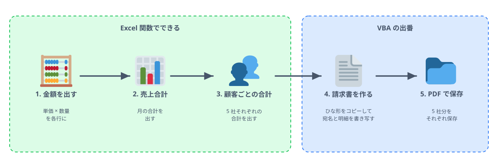
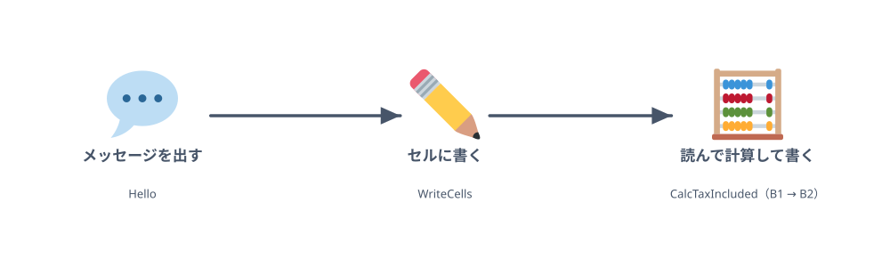
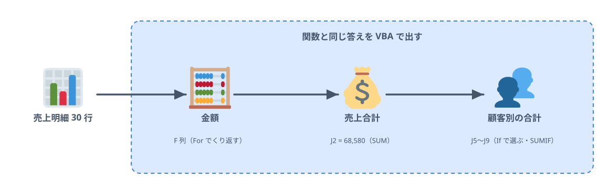
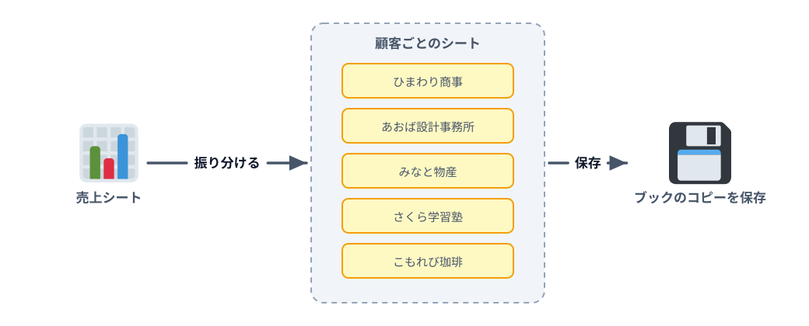

# はじめての VBA ハンズオン

**Excel 作業を自動化しよう。** VBA をまったく触ったことがない人、少し触ったことがある人のためのハンズオンです。

文法を順番に覚える講座ではありません。「毎月の請求書づくりが面倒」という身近な課題から始めて、手作業 → Excel 関数 → VBA と道具を持ち替えながら解決していきます。どこまでが関数で十分で、どこから VBA が効くのか。その見極めも一緒に持ち帰ってください。

この教材は **Excel（VBA）** と **Google スプレッドシート（Apps Script）** の両方に対応しています。どちらで進めるかは [Excel と Google スプレッドシート](./sections/README.md) で選べます。

## 持ち帰ってほしいこと

- VBA の基本的なコードを読んで、何をしているか分かる
- 自分で（あるいは AI が）書いたコードが動かないとき、デバッガーで原因を調べられる
- Excel 関数と VBA を使い分けられる
- ボタンひとつで帳票を作る、という業務の自動化を一度やり切った経験

## このハンズオンで作るもの

架空の文房具店「そよかぜ文具店」の、月末の請求書づくりを自動化します。章ごとに作るものを、図で紹介します。いくつかの章には、その場で動かせるデモも置きました（ブラウザ上の再現です。「▶ 実行」を押してみてください）。

### 1. そのExcel作業、本当に手作業が必要？

最初の章ではコードを書かず、今日解決する課題を確かめます。そよかぜ文具店では、毎月 30 行ほどの売上明細から顧客ごとの請求額を出し、5 社分の請求書を作って PDF にしています。この作業のうち、集計は Excel 関数で十分に片付き、シートを作る・ファイルを保存するといった操作は VBA の出番です。どこまでを関数で、どこからを VBA で解決するかを、ここで見極めます。最後には、ボタンひとつで 5 社分の請求書ができるようになります。

### 2. はじめてのマクロを動かそう

マクロを書く画面（Excel は VBE、スプレッドシートは Apps Script エディタ）を開き、はじめてのマクロを動かします。作るのは 3 つの小さなマクロです。メッセージの小窓を出す `Hello`、セルに文字や数を書き込む `WriteCells`、B1 の税抜価格を読んで税込価格を計算し、B2 に書く `CalcTaxIncluded` です。マクロの形、セルの指し方、変数の使い方という、このあとの章で毎回使う基本がそろいます。自分で書いたマクロが動けば、この章は完成です。

::::sheetdemo[CalcTaxIncluded を実行すると、B2 に税込価格が入る]{}
before A1:B1 = 税抜価格, 1200
before A2 = 税込価格
B2 = 1320
::::

### 3. Excel関数をVBAで再現しよう

売上明細の集計を、まず Excel 関数で、次に同じ答えを VBA で出します。各行の金額（単価 × 数量）は `For` のくり返しで、売上合計は 0 から 1 行ずつ足していく形で、顧客別の合計は `If` で一致する行だけを選んで求めます。関数でも十分な処理をあえて VBA で書くのは、答えの分かっている問題でプログラミングの基本を練習するためです。思ったとおりに動かないときに、止めて変数の中身を見るデバッガーの使い方も覚えます。

::::sheetdemo[3 章で作るマクロを実行すると、金額・売上合計・顧客別の合計が入る]{src="03-reproduce-functions/01-calc-amounts" book="data/sales.xlsx" sheet="売上"}
F2:F31 = 1250, 2500, 1360, 1650, 1800, 6800, 360, 1200, 1250, 600, 11000, 60, 1100, 8160, 1800, 6800, 1100, 8160, 600, 120, 900, 360, 250, 1250, 250, 500, 2500, 3200, 500, 1200
J2 = 68580
J5:J9 = 13420, 14720, 20900, 10520, 9020
::::

### 4. VBAだからできること

関数ではできない操作を、講師のデモで見ていきます。Excel はブック・シート・セルという部品の入れ子でできていて、VBA はその部品を外から操作できます。この章では、表に色や罫線を付ける、顧客ごとに新しいシートを作って明細を振り分ける、ブックのコピーを日時入りの名前で保存する、といった操作を順に試します。それぞれの操作は、次の章で請求書を作るための部品になります。条件付き書式のように、関数や標準の機能で済むものは何かも合わせて確かめます。

### 5. ボタンひとつで請求書を作ろう

月末作業の仕上げとして、5 社分の請求書を作るマクロを書きます。請求書のひな形のシートをコピーして宛名を書き、売上明細からその顧客の行だけを明細に書き写し、合計を出します。これを顧客の数だけくり返し、それぞれを PDF にして保存します。最後にシートへボタンを置いて、ボタンを押すだけで全部が終わるようにします。3 章のくり返しと条件分岐、4 章のシート操作をそのまま組み合わせるだけで書けるのがポイントです。取引先が増えても、押す回数は 1 回のままです。

::::sheetdemo[請求書を作るマクロを実行すると、ひまわり商事の請求書ができる]{src="05-invoice-button/02-transfer-details" book="data/invoice.xlsx" sheet="請求書テンプレート" openTab="added"}
tabs = 請求書_ひまわり商事 <- 請求書テンプレート
請求書_ひまわり商事!A5 = ひまわり商事 御中
請求書_ひまわり商事!A6 = 〒104-0000 東京都中央区ひまわり 2-4-6
請求書_ひまわり商事!A7 = 総務部 山田 様
請求書_ひまわり商事!E3 = 2026/10/31
請求書_ひまわり商事!A12:E12 = 2026/10/07, ホッチキス, 680, 2, 1360
請求書_ひまわり商事!A13:E13 = 2026/10/07, コピー用紙, 550, 3, 1650
請求書_ひまわり商事!A14:E14 = 2026/10/08, ノート, 180, 2, 360
請求書_ひまわり商事!A15:E15 = 2026/10/13, コピー用紙, 550, 2, 1100
請求書_ひまわり商事!A16:E16 = 2026/10/15, ホッチキス, 680, 10, 6800
請求書_ひまわり商事!A17:E17 = 2026/10/21, ノート, 180, 5, 900
請求書_ひまわり商事!A18:E18 = 2026/10/23, 付箋, 250, 5, 1250
請求書_ひまわり商事!E33 = 13420
請求書_ひまわり商事!B9 = 13420
::::

## 過去のハンズオン

これまでに作ったハンズオンの一覧は [過去のハンズオン](./sections/PAST-HANDSON.md) にあります。

## このリポジトリについて

- 教材本文は `sections/` に、解説サイトは `site/` にあります（`site/` は `sections/` から生成）
- 練習用ブック（`.xlsx`）は `tools/build_workbooks.py` で生成しています
- ドキュメントサイト: <https://seekseep.github.io/excel-and-vba-handson/>

## ライセンス

このハンズオンの成果物と授業資料（本文・サンプルコード・練習用ブック・図・解説サイト）は、[CC0 1.0](https://creativecommons.org/publicdomain/zero/1.0/deed.ja)（パブリック ドメイン）で公開しています。社内の勉強会で使う、改変して配る、自分の教材に組み込むなど、許可を取らずに自由に使ってかまいません。クレジットの表記も不要です。

ただし、図の中の絵文字は [Twemoji](https://github.com/jdecked/twemoji)（© Twitter, Inc and other contributors）を使っていて、そのグラフィックは [CC BY 4.0](https://creativecommons.org/licenses/by/4.0/deed.ja) です。図をそのまま使うときは、Twemoji のクレジットを残してください。

学習用の教材です。登場する会社・人物・住所はすべて架空のものです。
