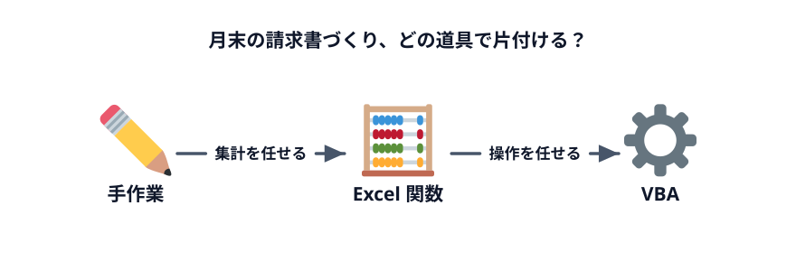
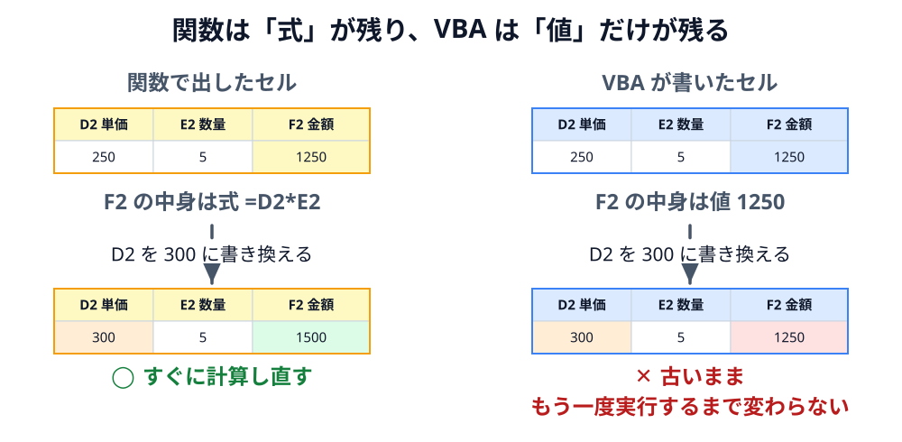

# そのExcel作業、本当に手作業が必要？

最初にコードは書きません。今日 1 日をかけて解決する「面倒な作業」を確認し、それをどの道具で片付けるかを考えます。

## 今日の題材: そよかぜ文具店の月末

そよかぜ文具店は、近所の会社や塾に文房具を卸している小さなお店です。注文があるたびに、Excel の「売上」シートに 1 行ずつ記録しています。

| 日付 | 顧客 | 商品 | 単価 | 数量 | 金額 |
|---|---|---|---|---|---|
| 2026/10/02 | あおば設計事務所 | 付箋 | 250 | 5 | 1,250 |
| 2026/10/06 | みなと物産 | 付箋 | 250 | 10 | 2,500 |
| 2026/10/07 | ひまわり商事 | ホッチキス | 680 | 2 | 1,360 |
| … | … | … | … | … | … |

10 月は 30 行、取引先は 5 社でした。月末になると、店長は次の作業をします。

## 手作業の何がつらいのか

全部手でやっても、30 行・5 社なら 1 時間もかからないかもしれません。それでも次の問題が残ります。

- **毎月やってくる** — 1 回 1 時間でも、1 年で 12 時間
- **間違える** — 行の見落とし、転記ミス、別の会社の明細の混入。請求書の間違いは信用に関わる
- **人に任せられない** — 手順が店長の頭の中にしかない
- **量が増えると破綻する** — 取引先が 50 社になったら？

## Excel 関数でできること

| 作業 | 関数 |
|---|---|
| 金額 | `=D2*E2` を下までコピー |
| 売上合計 | `=SUM(F2:F31)` |
| 顧客ごとの合計 | `=SUMIF(B2:B31, "ひまわり商事", F2:F31)` |

**集計だけなら関数で十分** です。

## VBA でできること

関数は「セルに値を出す」道具なので、4・5 のような「シートを増やす」「ファイルを保存する」といった **操作** はできません。

VBA（Visual Basic for Applications）は、Excel の操作を手順として書いておき、何度でも実行できる仕組みです。人がマウスとキーボードでやっていることは、ほぼ VBA で書けます。

- シートをコピーして名前を付ける
- 条件に合う行だけを別のシートに書き写す
- 色や罫線を付ける
- PDF やブックのコピーを保存する
- ボタン（スプレッドシートではメニュー）を押したら、ここまでを全部まとめて実行する

この勉強会の第 3 章で作るマクロを、先に動かしてみましょう。「▶ 実行」を押すと、F 列の金額と、J 列の売上合計・顧客別の合計が一度に入ります（ブラウザ上の再現です）。

::::sheetdemo[第 3 章で作るマクロを実行すると、金額と集計が入る]{src="03-reproduce-functions/01-calc-amounts" book="book/sales.xlsx" sheet="売上"}
F2:F31 = 1250, 2500, 1360, 1650, 1800, 6800, 360, 1200, 1250, 600, 11000, 60, 1100, 8160, 1800, 6800, 1100, 8160, 600, 120, 900, 360, 250, 1250, 250, 500, 2500, 3200, 500, 1200
J2 = 68580
J5:J9 = 13420, 14720, 20900, 10520, 9020
::::

## 関数と VBA の違い

関数は式が残るので、どう計算したかを後から誰でも確かめられます。VBA の結果は、ボタンやメニューで実行したときにだけ書き込まれます。

| | Excel 関数 | VBA |
|---|---|---|
| 得意なこと | セルの値を計算する | 操作の手順をくり返す |
| 覚えること | 関数名と引数 | 文法と、Excel の部品（ブック・シート・セル）の扱い方 |
| 共有 | `.xlsx` で誰でも開ける | `.xlsm` で保存し、開く人がマクロを許可する |

どちらが上ということはありません。**関数で済むところは関数で、関数でできないところを VBA で** が基本です。今日の流れもこの順番になっています。

## 今日の進め方

1. **第 2 章** — VBA を書く画面に慣れて、はじめてのマクロを動かす
2. **第 3 章** — 関数でやった集計を、あえて VBA でも書いてみる（目標・小）。「これは関数で十分だった」を体験する
3. **第 4 章** — 関数ではできない操作を VBA でやってみせる
4. **第 5 章** — ボタン（スプレッドシートではメニュー）を押すと 5 社分の請求書ができるようにする（目標・中）

第 3 章は全員が完成できる大きさにしてあります。第 5 章は時間内に終わらなくても、完成コードを持ち帰って動かせるようにしてあります。

:::notice[スプレッドシートで参加する人へ]
同じ流れを Google スプレッドシートと Apps Script（GAS）で進められます。「関数でできること／できないこと」の線引きはスプレッドシートでもほとんど同じです（スプレッドシートの関数もシートを増やしたり PDF を作ったりはできません）。
:::

## 確認クイズ

:::questions
- 顧客ごとの売上合計は、SUMIF 関数で求められる [o]
- 関数を使って、顧客ごとに新しいシートを作ることができる [x]
- VBA で書き込んだ値は、元のデータが変わると自動で計算し直される [x]
- マクロを含むブックは `.xlsm` 形式で保存する [o]
:::

:::faq

### マクロと VBA は何が違うのですか？

マクロは「Excel の操作を自動で実行する手順」のこと、VBA はその手順を書くための言語です。「マクロを VBA で書く」と考えてください。「マクロの記録」で作ったマクロも、中身は VBA で書かれています。スプレッドシートでは、同じ役割を Apps Script（言語は JavaScript）が担います。

### マクロ付きのブックは危ないと聞きました。大丈夫ですか？

マクロはファイルを消したり外部と通信したりもできるので、**出所の分からないブックのマクロは有効にしない** のが鉄則です。この教材では、節を始めるブックはマクロなしで配り、マクロは自分で書きます。節の最後で配るマクロ入りのブックに入っているのは、本文で中身を説明した完成コードだけです。自分で書いて中身を説明できるマクロなら、怖がる必要はありません。

### 集計ならピボットテーブルや Power Query でもよいのでは？

はい。1〜3 の集計は、ピボットテーブルや Power Query のほうが向いている場面も多いです。この教材では、いちばん身近な関数を代表に置いています。ただ、どれも「データを整えて表にする」道具で、顧客ごとにシートを作って PDF で保存する、という **操作** はできません。その部分が VBA の出番、という線引きは変わりません。

### 今から VBA を学ぶ意味はありますか？ Office Scripts や Python in Excel は？

Office Scripts は TypeScript で書くクラウド側の自動化、Python in Excel はセルの中でクラウド上の Python を動かす分析向けの機能です。どちらも手元の PC のファイルやフォルダは扱えません。デスクトップの Excel で「シートを作って PDF を保存する」まで一気にやるなら、今も VBA がいちばん手軽です。また、「部品をたどる」「くり返す」「条件で分ける」という考え方は、どの言語にもそのまま持っていけます。

### プログラミングをしたことがなくても、ついていけますか？

大丈夫です。Excel でセルに入力したり、関数を使ったりできれば十分です。この教材で書くコードはどれも短く、1 行ずつ意味を説明しています。各節の最後には完成コードもあるので、詰まったときは答え合わせをしながら進めてください。

### この程度の作業なら、Excel ではなく Web アプリやデータベースで作るべきではありませんか？

使う人の数と、求められる条件で決めます。数人で月に 1 回使う作業なら、Excel とマクロで十分なことがほとんどです。多くの人が同時に入力する、権限を細かく分ける、変更の記録を残す、データが数十万行を超える、といった条件が出てきたら、Web アプリやデータベースを検討します。最初から大きな仕組みを作るより、まず Excel で手順を固めておくと、あとで置き換えるときの仕様にもなります。

:::
