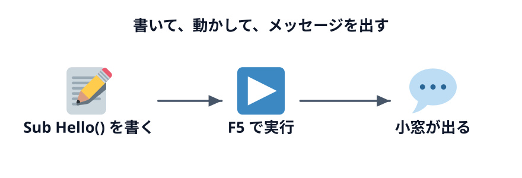

# はじめてのマクロ



VBA を書く画面を開いて、メッセージを出すだけの小さなマクロを動かします。「書く → 実行する」の手順に慣れるのが、この節の目的です。

まだ準備が済んでいない人は、先に [Excel の準備](../../00-setup/01-excel/LECTURE.md)（または [スプレッドシートの準備](../../00-setup/02-sheets/LECTURE.md)）を済ませてください。

## マクロを書く場所を開く

:::::platform
::::excel
1. Excel で **空白のブック** を新しく作る
2. 「開発」タブ →「Visual Basic」（`Alt` + `F11`）で VBE を開く
3. VBE の「挿入」→ **標準モジュール** を押す

右側に白いコード画面が開きます。ここにマクロを書きます。
::::
::::sheets
1. [Google スプレッドシート](https://sheets.new) で **空白のスプレッドシート** を新しく作る
2. 「拡張機能」→ **Apps Script** を押す
3. 開いたエディタの `コード.gs` の中身（`function myFunction() { }`）を消す

ここにマクロ（関数）を書きます。
::::
:::::

## はじめてのマクロ

次のコードを書いてください。まずは自分で入力してみましょう（この節の末尾に完成コードもあります）。

:::::platform
::::excel
```vb
Sub Hello()
    MsgBox "こんにちは、VBA！"
End Sub
```

- `Sub Hello()` 〜 `End Sub` … 「Hello という名前の手順」のはじまりと終わり。VBA では、この 1 かたまりを **マクロ** と呼びます
- `MsgBox "..."` … メッセージの小窓を出す命令。`"` で囲んだ部分が **文字列** です
::::
::::sheets
```js
function hello() {
  SpreadsheetApp.getUi().alert('こんにちは、Apps Script！');
}
```

- `function hello() {` 〜 `}` … 「hello という名前の手順」のはじまりと終わり。GAS ではこれを **関数** と呼びます（VBA の `Sub` にあたります）
- `SpreadsheetApp.getUi().alert('...')` … スプレッドシートの画面に小窓を出す命令。`'` で囲んだ部分が **文字列** です
::::
:::::

## 実行する

:::::platform
::::excel
`Sub Hello()` と `End Sub` の間のどこかをクリックしてから、**`F5`** を押します（ツールバーの ▶ でも同じです）。Excel の画面に「こんにちは、VBA！」と出れば成功です。

Excel の画面からも実行できます。「開発」タブ →「マクロ」で一覧から `Hello` を選び、「実行」を押してください。
::::
::::sheets
1. `Ctrl` + `S` で保存する
2. 上部の関数の選択欄で `hello` を選び、**実行** を押す
3. 初回は「承認が必要です」と出るので、[初回の承認](../../00-setup/02-sheets/LECTURE.md#初回の承認) の手順で許可する

スプレッドシートのタブに戻ると「こんにちは、Apps Script！」と出ています。
::::
:::::

### ボタンから実行する

マクロは、シートに置いた **ボタン** からも実行できます。ボタンに「押したらこのマクロを動かす」と登録しておけば、VBE やエディタを開かずに、ボタンを押すだけで動きます。

:::::platform
::::excel
第 3 章からの練習用ブックには、その章で書くマクロのボタンが最初から置いてあります。この節の完成ブック（末尾の「この節の完成コード」からダウンロードできる `first-macro.xlsm`）にも **あいさつする** ボタンがあり、押すと `Hello` が動きます。ボタンを自分で置く方法は 5-3 で扱います。
::::
::::sheets
スプレッドシートでは、図形にスクリプトを割り当ててボタンにします。置き方は 5-3 で扱います。
::::
:::::

ブラウザ上で再現したデモで、実行の流れを試してみましょう。

:::::platform
::::excel
「開発」タブの「マクロ」を押し、一覧から `Hello` を選んで「実行」を押します。
::::
::::sheets
Apps Script エディタの関数の選択欄で `hello` を選び、「▶ 実行」を押します。
::::
:::::

::::sheetdemo[Hello を実行すると、メッセージの小窓が出る]{range="A1:E6" macro="Hello"}
msgbox = こんにちは、VBA！
msgbox.sheets = こんにちは、Apps Script！
::::

:::warning[赤い字になった・エラーが出たときは]
- 記号（`"` `(` `)` `.` `=`）とスペースは **半角** で書く。全角のスペースや `”` が混ざると動きません
- `End Sub`（GAS なら `}`）を消していないか確かめる
- Excel で `F5` を押したときに「マクロ」の一覧が出たら、カーソルが `Sub` の外にあります
:::

::codeview[この節の完成コード]

:::faq

### ノートパソコンで `F5` を押しても実行されません

ノートパソコンでは、`F5` が画面の明るさや音量のキーになっていることがあります。`Fn` キーを押しながら `F5` を押すか、VBE のツールバーの ▶ を押してください。

### 左の一覧の「Sheet1」や「ThisWorkbook」をダブルクリックして、そこに書いてしまいました

そこにも書けて、`Hello` も動きます。ただ、シートやブックのモジュールは「そのシートやブックで何かが起きたとき」に動かすマクロを置く場所です。この教材では「挿入」→「標準モジュール」で作った `Module1` に書く前提で進めるので、コードを切り取って `Module1` に貼り直してください。

### 完成コードの先頭にある `Option Explicit` は何ですか？

「変数は `Dim` で宣言してから使う」ことを強制する宣言です。これが無いと、変数名を打ち間違えても新しい変数として扱われ、エラーにならないまま結果だけがおかしくなります。VBE の「ツール」→「オプション」で **変数の宣言を強制する** にチェックを入れておくと、新しいモジュールに自動で入ります（[Excel の準備](../../00-setup/01-excel/LECTURE.md) を参照）。

### `Sub` ではなく `Function` で書いてはいけないのですか？

`Function` は値を返す手順で、セルの数式から自作の関数として呼べます。一方、「開発」タブの「マクロ」の一覧やボタンから実行できるのは、引数の無い `Sub` だけです。操作を実行するマクロは `Sub`、と覚えておけば十分です（`Function` は付録で扱います）。GAS には区別がなく、どちらも `function` で書きます。

### ボタンを押さずに、選んだり大きさを変えたりするには？

ボタンを **右クリック** すると、マクロを動かさずにボタンを選択できます。文字の編集・大きさや位置の変更、「マクロの登録」（どのマクロを動かすかの確認や変更）は、右クリックのメニューからできます。

### VBE を閉じてしまいました。書いたコードは消えましたか？

消えていません。コードはブックの中に入っているので、`Alt` + `F11`（Mac は `Option` + `F11`）でもう一度開けば残っています。ただし、ブックを `.xlsm` で保存せずに閉じるとコードは消えます。スプレッドシートの Apps Script は、エディタで保存しておけばそのまま残ります。

### GAS で `SpreadsheetApp.getUi()` が「この状況では呼び出せません」というエラーになります

`getUi()` は、スプレッドシートに紐づいたスクリプトを、スプレッドシートを開いた状態で動かしたときにしか使えません。Google ドライブから直接作った（どのスプレッドシートにも紐づかない）スクリプトや、時間を決めて動かすトリガーから実行すると、このエラーになります。スプレッドシートの「拡張機能」→「Apps Script」から開いたエディタで書き、そこから実行してください。

:::
