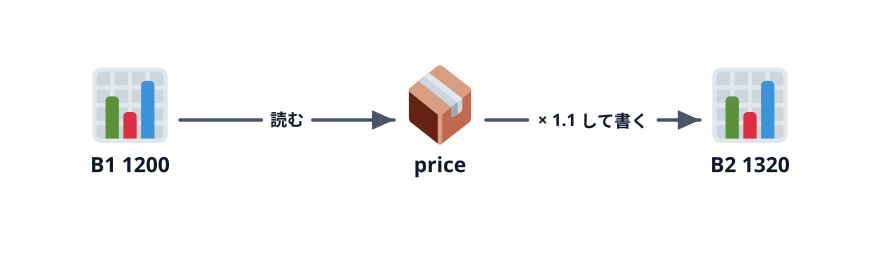

# セルと変数



2-1 で作ったマクロの下に続けて書いていきます。セルに書く、セルから読んで計算する。この 2 つができれば、第 3 章の集計に必要な道具はそろいます。

## セルに書き込む

次は、メッセージではなくセルに書いてみます。さっきのマクロの下に続けて書きます。

:::::platform
::::excel
```vb
Sub WriteCells()
    Range("A1").Value = "税抜価格"
    Range("B1").Value = 1200
    Range("A2").Value = "税込価格"
End Sub
```

- `Range("A1")` … A1 のセル
- `.Value` … そのセルの値
- `=` … **右の値を左に入れる**。算数の「等しい」ではありません
::::
::::sheets
```js
function writeCells() {
  const sheet = SpreadsheetApp.getActiveSheet();
  sheet.getRange('A1').setValue('税抜価格');
  sheet.getRange('B1').setValue(1200);
  sheet.getRange('A2').setValue('税込価格');
}
```

- `SpreadsheetApp.getActiveSheet()` … いま開いているシート。`const sheet =` で `sheet` という名前を付けておき、以降はそれを使います
- `sheet.getRange('A1')` … そのシートの A1 のセル
- `.setValue(...)` … セルに値を書く
::::
:::::

実行して、シートの A1・B1・A2 に値が入ったことを確かめてください。

セルは「行と列の番号」でも指せます。A1 は 1 行目の 1 列目、B1 は 1 行目の 2 列目です。

| 番地で指す | 番号で指す |
|---|---|
| `Range("B1")` | `Cells(1, 2)` |
| `sheet.getRange('B1')` | `sheet.getRange(1, 2)` |

番号で指す書き方は、第 3 章で「2 行目から 31 行目まで順番に」処理するときに使います。

## セルから読んで、計算して、書く

B1 の税抜価格を読んで、税込価格（10%）を B2 に書きます。

:::::platform
::::excel
```vb
Sub CalcTaxIncluded()
    Dim price As Long
    Dim taxIncluded As Long

    price = Range("B1").Value
    taxIncluded = Int(price * 1.1)
    Range("B2").Value = taxIncluded
End Sub
```

- `Dim price As Long` … `price` という名前の **変数**（値を入れておく箱）を用意する。`As Long` は「整数を入れる箱」という意味
- `price = Range("B1").Value` … B1 の値を `price` に入れる
- `Int(price * 1.1)` … 1.1 倍して、小数点以下を切り捨てる
::::
::::sheets
```js
function calcTaxIncluded() {
  const sheet = SpreadsheetApp.getActiveSheet();
  const price = sheet.getRange('B1').getValue();
  const taxIncluded = Math.floor(price * 1.1);
  sheet.getRange('B2').setValue(taxIncluded);
}
```

- `const price = ...` … `price` という名前の **変数**（値を入れておく箱）を作って、B1 の値を入れる
- `.getValue()` … セルの値を読む
- `Math.floor(price * 1.1)` … 1.1 倍して、小数点以下を切り捨てる
::::
:::::

B2 に `1320` と出れば成功です。B1 を `3000` に書き換えてもう一度実行すると、B2 は `3300` になります。

### 型と計算

VBA の変数には、何を入れる箱かを `As` で指定します（**型**）。この教材で使うのは次の 4 つです。

| 型 | 入れるもの | 例 |
|---|---|---|
| `Long` | 整数 | 行番号、個数、金額 |
| `String` | 文字列 | 顧客名、シート名 |
| `Double` | 小数 | 割合 |
| `Date` | 日付 | 発行日 |

計算の記号は `+`（足す）`-`（引く）`*`（掛ける）`/`（割る）です。

GAS では型を書きません。そのかわり、あとで中身を変える変数は `let`、変えない変数は `const` で作ります。

:::notice[変数は必要なときだけ]
Excel ではセルそのものがデータの置き場所です。`Range("B1").Value * 1.1` のように、セルを直接使っても計算できます。変数は「何度も使う値」や「名前を付けたほうが読みやすい値」に絞って使えば十分です。
:::

## 保存する

:::::platform
::::excel
「ファイル」→「名前を付けて保存」で、ファイルの種類を **Excel マクロ有効ブック（\*.xlsm）** にして保存します。`.xlsx` で保存するとマクロが消えるので注意してください。
::::
::::sheets
スプレッドシートもスクリプトも自動で保存されます（エディタは `Ctrl` + `S` で保存）。
::::
:::::

## やってみよう

1. 送料 500 円を足した「支払金額」を A3・B3 に出すマクロを書く
2. `Hello` のメッセージを、B2 の税込価格を表示するように変える（ヒント: VBA は `"税込価格は " & Range("B2").Value & " 円です"`、GAS は `+` で文字列をつなぐ）

## 次へ

[金額を計算する](../../03-reproduce-functions/01-calc-amounts/LECTURE.md) で、売上明細の集計に挑戦します。

::codeview[この節の完成コード]
