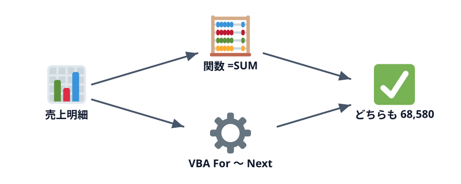
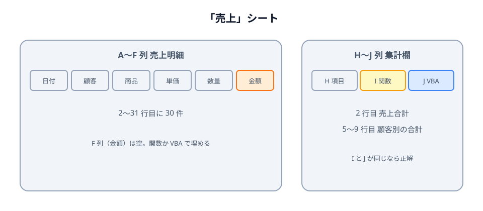

# 金額を計算する



そよかぜ文具店の 10 月の売上明細を集計します。まず Excel 関数で答えを出し、**同じ答えを VBA でも出します**。関数で十分な処理をあえて VBA で書くのは、プログラミングの基本（くり返しと条件分岐）を、答えの分かっている問題で練習するためです。

この節では、関数で答えを用意したあと、各行の金額（単価 × 数量）を VBA で計算します。

## 準備

:::download
[練習用ブックをダウンロード](./start.zip)
[サンプルのスプレッドシートをコピー](./spreadsheet)
:::

マクロは、本文に沿って自分で書いていきます。

:::::platform
::::excel
ZIP を展開すると、練習用ブックがあります。

```text
01-calc-amounts/
└── data/sales.xlsx        練習用ブック（マクロなし）
```

1. `data/sales.xlsx` を Excel で開く（保護ビューの黄色いバーが出たら「編集を有効にする」）
2. すぐに「名前を付けて保存」で **Excel マクロ有効ブック（\*.xlsm）** として保存する
3. `Alt` + `F11` で VBE を開き、「挿入」→「標準モジュール」
::::
::::sheets
1. 上の **サンプルのスプレッドシートをコピー** を押し、「コピーを作成」を押す（自分のドライブにコピーができて開きます）
2. コピーしたスプレッドシートで「拡張機能」→「Apps Script」
::::
:::::

節の最後の「この節の完成コード」からは、この節を終えた状態のブック（Excel はマクロ入りの `.xlsm`）と完成コードをダウンロードできます。答え合わせ用です。まずは自分で入力し、詰まったときに見てください。

:::::platform
::::excel
完成コードを VBE に入れる方法は 2 つあります。

1. **コピーして貼る** — 節の末尾にある完成コードからコピーし、標準モジュールに貼る
2. **インポートする** — VBE の「ファイル」→「ファイルのインポート」で `vba/SalesSummary.bas` を選ぶ
::::
::::sheets
完成コードは、節の末尾からコピーして Apps Script エディタに貼ります。
::::
:::::

「売上」シートの中身はこうなっています。



- **A〜E 列** … 30 行の売上明細（2〜31 行目）。F 列「金額」は空
- **H〜J 列** … 集計欄。黄色い **I 列に関数で**、その隣の **J 列に VBA で** 答えを出して見比べます
- **L 列** … マクロを動かすボタン（Excel のみ）。この章で書く 3 つのマクロ（**金額を計算**・**売上合計を出す**・**顧客別に集計**）のボタンが、先に置いてあります

## まずは関数で解く

VBA の前に、関数で答えを出しておきます。これが VBA の答え合わせになります。

| セル | 入れる式 | 意味 |
|---|---|---|
| F2 | `=D2*E2` | 金額 = 単価 × 数量。F31 までコピーする |
| I2 | `=SUM(F2:F31)` | 売上合計 |
| I5 | `=SUMIF($B$2:$B$31, H5, $F$2:$F$31)` | H5 の顧客の合計。I9 までコピーする |

I2 が **68,580**、I5（ひまわり商事）が **13,420** になれば正解です。

ここまでで集計は終わりました。ここからは、同じことを VBA にやらせます。

## 1 行分の金額を VBA で出す

いきなり全部ではなく、2 行目だけをやってみます。

:::::platform
::::excel
```vb
Sub CalcAmounts()
    Cells(2, 6).Value = Cells(2, 4).Value * Cells(2, 5).Value
End Sub
```

`Cells(2, 6)` は 2 行目の 6 列目、つまり F2 です。`Cells(2, 4)`（D2: 単価）と `Cells(2, 5)`（E2: 数量）を掛けて入れています。
::::
::::sheets
```js
function calcAmounts() {
  const sheet = SpreadsheetApp.getActiveSpreadsheet().getSheetByName('売上');
  const amount = sheet.getRange(2, 4).getValue() * sheet.getRange(2, 5).getValue();
  sheet.getRange(2, 6).setValue(amount);
}
```

`getSheetByName('売上')` で「売上」シートを名前で取ってきます。`getRange(2, 6)` は 2 行目の 6 列目、つまり F2 です。
::::
:::::

実行すると、F2 の式 `=D2*E2` が消えて、値の `1250` に置き換わります。

:::notice[VBA が書くのは「値」]
関数の式は「どう計算したか」がセルに残りますが、VBA が書いた値には残りません。D2 を書き換えても F2 は変わらず、もう一度マクロを実行するまで古いままです。関数と VBA の大きな違いの 1 つです。
:::

## くり返す（For）

3 行目、4 行目…と 31 行目まで同じことをしたいので、行番号を変数 `i` にして **くり返し** ます。

:::::platform
::::excel
:::code[CalcAmounts を書き換える]{filepath=Module1}
```vb
Sub CalcAmounts()
    Dim i As Long

    For i = 2 To 31
        Cells(i, 6).Value = Cells(i, 4).Value * Cells(i, 5).Value
    Next i
End Sub
```
:::

- `For i = 2 To 31` 〜 `Next i` … `i` を 2, 3, 4, … 31 と 1 ずつ増やしながら、間の行を 30 回くり返す
- `Cells(i, 6)` … `i` 行目の F 列。`i` が 2 のときは F2、3 のときは F3
::::
::::sheets
:::code[calcAmounts を書き換える]{filepath=コード.gs}
```js
function calcAmounts() {
  const sheet = SpreadsheetApp.getActiveSpreadsheet().getSheetByName('売上');
  for (let i = 2; i <= 31; i++) {
    const amount = sheet.getRange(i, 4).getValue() * sheet.getRange(i, 5).getValue();
    sheet.getRange(i, 6).setValue(amount);
  }
}
```
:::

- `for (let i = 2; i <= 31; i++) { }` … `i` を 2 から始め、31 以下のあいだ、1 ずつ増やしながら `{ }` の中をくり返す
- `getRange(i, 6)` … `i` 行目の F 列
::::
:::::

F2〜F31 がすべて値で埋まり、I2 の SUM が 68,580 のままなら成功です。

### 最後の行を自動で探す

`31` と書いてしまうと、11 月に明細が 40 行になったときに直す必要があります。データのある最後の行を探す書き方に変えましょう。

:::::platform
::::excel
```vb
Dim lastRow As Long
lastRow = Cells(Rows.Count, 1).End(xlUp).Row
For i = 2 To lastRow
```

`Cells(Rows.Count, 1)` はシートのいちばん下の A 列のセルです。そこから `.End(xlUp)`（`Ctrl` + `↑` と同じ）で上に飛ぶと、データのある最後のセルに止まります。その `.Row`（行番号）が `lastRow` です。
::::
::::sheets
```js
const lastRow = sheet.getLastRow();
for (let i = 2; i <= lastRow; i++) {
```

`getLastRow()` は、データのある最後の行番号を返します。
::::
:::::

## 動かしてみる

完成した `CalcAmounts` を実行すると、F 列の 2 行目から最後の行まで、上から順に金額が入ります。ブラウザ上で再現したデモで試してみましょう。

:::::platform
::::excel
「売上」シートの **金額を計算** ボタンを押します（「開発」タブ →「マクロ」で `CalcAmounts` を選んで「実行」を押しても同じです）。

練習用ブックの「売上」シートの右側には、この章で書くマクロを動かすボタンが置いてあります。ボタンには「押したらどのマクロを動かすか」が登録してあるので、VBE を開かなくても実行できます。
::::
::::sheets
Apps Script エディタの関数の選択欄で `calcAmounts` を選び、「▶ 実行」を押します。
::::
:::::

::::sheetdemo[CalcAmounts を実行すると、F 列に金額が入る]{book="data/sales.xlsx" sheet="売上" macro="CalcAmounts"}
F2:F31 = 1250, 2500, 1360, 1650, 1800, 6800, 360, 1200, 1250, 600, 11000, 60, 1100, 8160, 1800, 6800, 1100, 8160, 600, 120, 900, 360, 250, 1250, 250, 500, 2500, 3200, 500, 1200
::::

::codeview[この節の完成コード]{defaultFile="vba/SalesSummary.bas"}

:::faq

### ボタンを押すと「マクロ 'CalcAmounts' が見つかりません」と出ます

ボタンに登録してある名前のマクロが、まだブックに無いときに出ます。`Sub` の名前（`CalcAmounts`）の綴りが合っているか、コードを書いたブックとボタンのあるブックが同じかを確かめてください。`.xlsx` のままではマクロを保存できないので、マクロを書いたら `.xlsm` で保存し直します。

### 実行したら、F 列の式 `=D2*E2` が消えてしまいました

正常です。VBA が F 列に計算結果の **値** を上書きしたためです。式に戻したいときは、F2 に `=D2*E2` を入れて F31 までコピーし直すか、ZIP の `data/sales.xlsx` から始め直してください。

### 別のシートを開いたまま実行したら、そのシートに書き込まれました

`Cells(...)` や `Range(...)` だけを書くと、**いま開いているシート** が対象になります。「売上」シートを表示してから実行してください。シートを名前で指定する書き方（`Worksheets("売上").Cells(...)`）は 4-1 で扱います。GAS のコードは `getSheetByName('売上')` で最初からシートを指定しているので、この問題は起きません。

### 最後の行を探すのに `UsedRange` や `CurrentRegion` ではだめですか？

使えますが、それぞれクセがあります。`UsedRange` は書式だけが残ったセルも「使っている」と数えるので、データより下まで広がることがあります。`CurrentRegion` は途中に空行があるとそこで切れます。`Cells(Rows.Count, 1).End(xlUp)` は「A 列の最後の値」と意味がはっきりしているので、この教材ではこれを使います。

GAS の `getLastRow()` は **シート全体で** 最後に値のある行を返します。表の下にメモなどを書くと、そこまでくり返してしまう点に注意してください。

### セルを 1 つずつ読み書きするのは遅くないですか？

遅いです。30 行なら一瞬ですが、数万行になると目に見えて待たされます。特に GAS は `getValue` / `setValue` のたびに Google のサーバーとやりとりするので顕著です。範囲をまとめて配列に読み込み、計算してからまとめて書き戻すのが定番の高速化です（VBA は `Range("D2:E31").Value`、GAS は `getValues()` / `setValues()`）。この教材では、上から順に読める形を優先して 1 つずつ書いています。

### `For i = 2 To 31` は、なぜ 1 からではなく 2 から始めるのですか？

1 行目は「日付」「顧客」などの見出しで、データは 2 行目から始まっているからです。1 から始めると、見出しの「単価」×「数量」を計算しようとしてエラーになります。

### 最後の行を A 列で数えているのはなぜですか？ 途中に空のセルがあったらどうなりますか？

`End(xlUp)` はシートのいちばん下から上に向かって探すので、途中に空のセルがあっても影響を受けません（上から `Ctrl` + `↓` で探す方法だと、空のセルで止まってしまいます）。ただし、数えた列の最後の行が空だとその行は数えられないので、必ず値が入る列（ここでは日付の A 列）を選びます。GAS の `getLastRow()` は、どの列かに関係なくシートで値のある最後の行を返すので、表の横にメモなどを書くとずれることがあります。

:::
