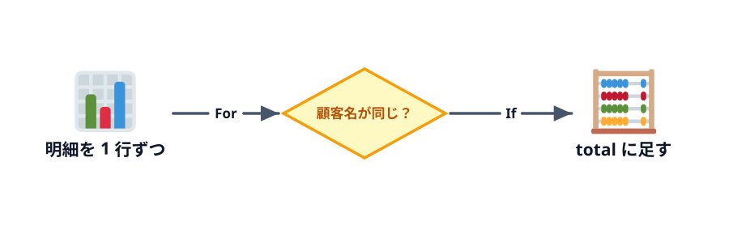

# SUM と SUMIF を再現する



3-1 の続きです。3-1 のブックとモジュールをそのまま使います（3-1 で F 列の金額を埋めた状態から始めます）。

:::download
[この節を始めるブックをダウンロード](./start-book)
[サンプルのスプレッドシートをコピー](./start-spreadsheet)
:::

前の節から続けている人は、そのブックのまま進めてください。ここから始める人は、上のボタンから 3-1（金額を計算する）を終えた状態のブックをダウンロードしてください。Excel では、マクロ入りのブック（`.xlsm`）を開くときに [マクロを有効にする](../../00-setup/01-excel/LECTURE.md#ダウンロードしたマクロ入りのブック) 必要があります。スプレッドシートでは、上の「サンプルのスプレッドシートをコピー」で自分のドライブにコピーを作り、「コードをダウンロード」の ZIP にある `gas/` のコードを Apps Script エディタに貼って、前の節を終えた状態にしてから進めてください。

**この章の完成条件:** VBA で集計した売上合計と顧客別の合計を、セルに出せる（関数の答えと一致する）。この節で達成します。

## 合計を出す（SUM の再現）

合計は「0 から始めて、1 行ずつ足していく」と考えます。電卓で足し算するときと同じです。

:::::platform
::::excel
```vb
Sub SumTotal()
    Dim lastRow As Long
    Dim i As Long
    Dim total As Long

    lastRow = Cells(Rows.Count, 1).End(xlUp).Row
    total = 0
    For i = 2 To lastRow
        total = total + Cells(i, 6).Value
    Next i
    Range("J2").Value = total
End Sub
```

`total = total + Cells(i, 6).Value` は「いまの `total` に `i` 行目の金額を足して、`total` に入れ直す」という意味です。
::::
::::sheets
```js
function sumTotal() {
  const sheet = SpreadsheetApp.getActiveSpreadsheet().getSheetByName('売上');
  const lastRow = sheet.getLastRow();
  let total = 0;
  for (let i = 2; i <= lastRow; i++) {
    total = total + sheet.getRange(i, 6).getValue();
  }
  sheet.getRange('J2').setValue(total);
}
```

`total = total + ...` は「いまの `total` に `i` 行目の金額を足して、`total` に入れ直す」という意味です。中身を書き換えるので `const` ではなく `let` で作ります。
::::
:::::

J2 が I2 と同じ **68,580** になれば成功です。

:::::platform
::::excel
「売上」シートの **売上合計を出す** ボタンを押します（「開発」タブ →「マクロ」で `SumTotal` を選んで「実行」を押しても同じです）。
::::
::::sheets
Apps Script エディタの関数の選択欄で `sumTotal` を選び、「▶ 実行」を押します。
::::
:::::

::::sheetdemo[SumTotal を実行すると、J2 に売上合計が入る]{book="book/sales.xlsx" sheet="売上" macro="SumTotal" macros="CalcAmounts,SumTotal,SumByCustomer"}
before F2:F31 = 1250, 2500, 1360, 1650, 1800, 6800, 360, 1200, 1250, 600, 11000, 60, 1100, 8160, 1800, 6800, 1100, 8160, 600, 120, 900, 360, 250, 1250, 250, 500, 2500, 3200, 500, 1200
J2 = 68580
::::

## 条件で分ける（SUMIF の再現）

顧客別の合計は「顧客名が一致する行だけ足す」です。ここで **条件分岐** を使います。

:::::platform
::::excel
```vb
Sub SumByCustomer()
    Dim lastRow As Long
    Dim i As Long
    Dim customerName As String
    Dim total As Long

    lastRow = Cells(Rows.Count, 1).End(xlUp).Row
    customerName = Range("H5").Value
    total = 0
    For i = 2 To lastRow
        If Cells(i, 2).Value = customerName Then
            total = total + Cells(i, 6).Value
        End If
    Next i
    Range("J5").Value = total
End Sub
```

- `If 条件 Then` 〜 `End If` … 条件が成り立つときだけ、間の行を実行する
- `Cells(i, 2).Value = customerName` … `i` 行目の顧客名（B 列）が H5 と同じか。`If` の中の `=` は「等しいか」の意味になります
::::
::::sheets
```js
function sumByCustomer() {
  const sheet = SpreadsheetApp.getActiveSpreadsheet().getSheetByName('売上');
  const lastRow = sheet.getLastRow();
  const customerName = sheet.getRange('H5').getValue();
  let total = 0;
  for (let i = 2; i <= lastRow; i++) {
    if (sheet.getRange(i, 2).getValue() === customerName) {
      total = total + sheet.getRange(i, 6).getValue();
    }
  }
  sheet.getRange('J5').setValue(total);
}
```

- `if (条件) { }` … 条件が成り立つときだけ `{ }` の中を実行する
- `===` … 左右が等しいか。`=`（入れる）と区別するために 3 つ並べます
::::
:::::

J5 が I5 と同じ **13,420** になれば成功です。

:::::platform
::::excel
「売上」シートの **顧客別に集計** ボタンを押します（「開発」タブ →「マクロ」で `SumByCustomer` を選んで「実行」を押しても同じです）。
::::
::::sheets
Apps Script エディタの関数の選択欄で `sumByCustomer` を選び、「▶ 実行」を押します。
::::
:::::

::::sheetdemo[SumByCustomer を実行すると、J5 に H5 の顧客の合計が入る]{book="book/sales.xlsx" sheet="売上" macro="SumByCustomer" macros="CalcAmounts,SumTotal,SumByCustomer"}
before F2:F31 = 1250, 2500, 1360, 1650, 1800, 6800, 360, 1200, 1250, 600, 11000, 60, 1100, 8160, 1800, 6800, 1100, 8160, 600, 120, 900, 360, 250, 1250, 250, 500, 2500, 3200, 500, 1200
J5 = 13420
::::
H5 を「みなと物産」に書き換えて実行すると、20,900 になります。

:::notice[条件が成り立たないときもしたいなら]
`Else`（GAS は `else`）で「それ以外のとき」を書けます。たとえば金額が 5,000 以上なら「大口」、それ以外なら「通常」と G 列に書く、などです。

```vb
If Cells(i, 6).Value >= 5000 Then
    Cells(i, 7).Value = "大口"
Else
    Cells(i, 7).Value = "通常"
End If
```
:::

::codeview[この節の完成コード]{defaultFile="vba/SalesSummary.bas"}

:::faq

### `total = 0` は書かなくても動くのでは？

VBA では、`Dim` した `Long` の変数は最初から `0` なので、書かなくても動きます。それでも「ここから数え始める」ことが読んで分かるように書いておきます。GAS では `let total;` だけだと中身が `undefined` になり、足し算の結果が `NaN`（数ではない）になるので、`= 0` が必須です。

### H5 の顧客名を書き換えたのに、J5 が変わりません

VBA が書き込んだのは値なので、元のデータが変わっても自動では計算し直されません。もう一度 `SumByCustomer` を実行してください。隣の I5（SUMIF）はすぐに変わります。これが関数と VBA の違いです。

### VBA から SUMIF 関数を呼び出すことはできませんか？

できます。`Application.WorksheetFunction.SumIf(Range("B2:B31"), Range("H5").Value, Range("F2:F31"))` のように、ワークシート関数の多くは VBA から呼べます。この節ではくり返しと条件分岐を練習するために、あえて自分で書いています。GAS には同じ仕組みがないので、自分で書くか、`setFormula` でセルに数式を入れることになります。

### SUMIF と VBA の `=` で、一致の判定は同じですか？

少し違います。SUMIF は英字の大文字と小文字を区別しませんが、VBA の `=` と GAS の `===` は区別します。前後のスペースは、どれも別の文字として扱います。データの表記がそろっていないときは、比べる前に `Trim`（GAS は `trim()`）でスペースを落とすなどの下ごしらえが必要です。

### `total = total + Cells(i, 6).Value` は、式として成り立っていないように見えます

プログラムの `=` は「等しい」ではなく「右側を計算して、左側に入れる」という意味です。まず右側の「いまの `total` に金額を足した値」を計算し、その結果を `total` に入れ直しています。

### `Long` で足していって、合計が大きくなりすぎることはありませんか？

`Long` で扱える整数は約 21 億までで、超えると「オーバーフローしました」（実行時エラー 6）になります。金額がそれを超えそうなときや、小数を含むときは `Double` を、お金の計算で小数の誤差を避けたいときは `Currency` を使います。GAS の数は 1 種類（倍精度の小数）で、整数なら約 9,000 兆まで正確に扱えます。

:::
