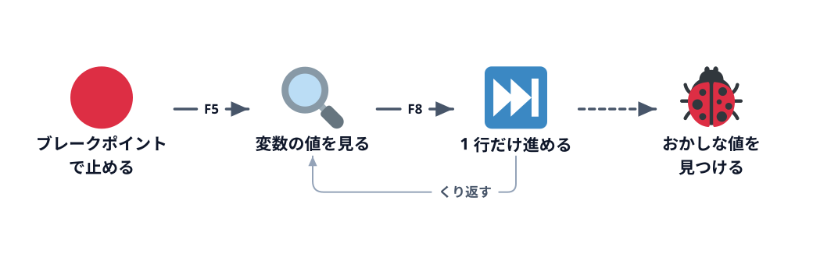

# デバッガーの紹介



3-2 の続きです。3-2 で書いた `SumTotal` を使って、**デバッガー** の使い方を覚えます。

デバッガーは、マクロを途中で止めて、そのときの変数の中身を見ながら 1 行ずつ進められる道具です。コードを眺めるだけでは分からない「実際に何が起きているか」が見えます。自分で書いたコードでも、AI が書いたコードでも、思ったとおりに動かないときに原因を調べる一番の手段です。

この節のマクロは正しく動きます。正しく動くものを 1 行ずつ追って、変数が変わっていく様子を見ておくと、次の 3-4 で間違いを探すときに「どこがおかしいか」に気づけるようになります。

## 止める場所を決める（ブレークポイント）

まず、マクロのどこで止めるかを決めます。この印を **ブレークポイント** と呼びます。

:::::platform
::::excel
`SumTotal` の `total = total + Cells(i, 6).Value` の行で、左の灰色の帯をクリックします（その行にカーソルを置いて `F9` でも同じ）。茶色の丸が付き、行に色が付けば置けています。もう一度クリックすると外れます。
::::
::::sheets
`sumTotal` の `total = total + ...` の行で、行番号の左をクリックします。紫の丸が付けば置けています。もう一度クリックすると外れます。
::::
:::::

## 実行して止める

:::::platform
::::excel
`SumTotal` の中にカーソルを置いて `F5` で実行します。ブレークポイントの行が **黄色** になって止まります。黄色い行は「これから実行する行」です（まだ実行されていません）。
::::
::::sheets
関数の選択欄で `sumTotal` を選び、**デバッグ** を押します（「実行」ではブレークポイントで止まりません）。ブレークポイントの行に色が付いて止まり、右側に「デバッガ」パネルが開きます。
::::
:::::

## 変数の中身を見る

止まっているあいだは、その時点の変数の値を見られます。

:::::platform
::::excel
「表示」→ **ローカル ウィンドウ** を開くと、`lastRow`、`i`、`total` の今の値が一覧で出ます。コードの上で変数にマウスを乗せても、値が小さく表示されます。

最初に止まったときは `i` が `2`、`total` が `0`、`lastRow` が `31` のはずです。
::::
::::sheets
右側のデバッガパネルの **変数** に、`lastRow`、`i`、`total` の今の値が出ます。

最初に止まったときは `i` が `2`、`total` が `0`、`lastRow` が `31` のはずです。
::::
:::::

## 1 行ずつ進める（ステップ実行）

:::::platform
::::excel
**`F8`**（Mac は `⌘` + `Shift` + `I`）を押すたびに、黄色い行が 1 行だけ進みます。これを **ステップ実行** と呼びます。

何回か押して、ローカル ウィンドウの `total` が `0` → `1250` → `3750` → `5110` … と増えていき、`Next i` を通るたびに `i` が 1 ずつ増えることを確かめてください。

途中で `F5` を押すと、次のブレークポイント（またはマクロの終わり）まで一気に進みます。
::::
::::sheets
デバッガの **ステップ オーバー**（↷）を押すたびに、止まっている行が 1 行だけ進みます。これを **ステップ実行** と呼びます。

何回か押して、変数の `total` が `0` → `1250` → `3750` → `5110` … と増えていき、1 周するたびに `i` が 1 ずつ増えることを確かめてください。

**再開**（▶）を押すと、次のブレークポイント（または関数の終わり）まで一気に進みます。
::::
:::::

## 止める

:::::platform
::::excel
ツールバーの ■（**リセット**）で実行を止めます。黄色い行が消えれば、元の編集できる状態に戻っています。ブレークポイントは残るので、要らなければクリックして外してください。
::::
::::sheets
デバッガの ■（**停止**）で実行を止めます。ブレークポイントは残るので、要らなければクリックして外してください。
::::
:::::

## ログに書き出す

止めずに、途中経過を書き出して確かめる方法もあります。くり返しの様子を一度に見たいときに便利です。

:::::platform
::::excel
`For` の中に次の 1 行を足して実行し、`Ctrl` + `G` で **イミディエイト ウィンドウ** を開きます。

```vb
Debug.Print i, Cells(i, 6).Value, total
```

1 行ごとに「行番号・金額・その時点の合計」が並びます。

イミディエイト ウィンドウには、式を直接打って確かめることもできます。`? Range("F2").Value` と打って `Enter` を押すと、F2 の値が表示されます。
::::
::::sheets
`for` の中に次の 1 行を足して実行し、下の **実行ログ** を見ます。

```js
console.log(i, sheet.getRange(i, 6).getValue(), total);
```

1 行ごとに「行番号・金額・その時点の合計」が並びます。
::::
:::::

ブラウザ上で再現したデモで、ログの出方を見てみましょう。

:::::platform
::::excel
「開発」タブの「マクロ」を押し、一覧から `SumTotal` を選んで「実行」を押します。
::::
::::sheets
Apps Script エディタの関数の選択欄で `sumTotal` を選び、「▶ 実行」を押します。
::::
:::::

::::sheetdemo[ログを足した SumTotal を実行すると、1 行ごとの途中経過が出る]{book="data/sales.xlsx" sheet="売上" macro="SumTotal" macros="CalcAmounts,SumTotal,SumByCustomer"}
before F2:F31 = 1250, 2500, 1360, 1650, 1800, 6800, 360, 1200, 1250, 600, 11000, 60, 1100, 8160, 1800, 6800, 1100, 8160, 600, 120, 900, 360, 250, 1250, 250, 500, 2500, 3200, 500, 1200
J2 = 68580
log = 2             1250          1250
log = 3             2500          3750
log = 4             1360          5110
log = 5             1650          6760
log = 6             1800          8560
log = 7             6800          15360
log = 8             360           15720
log = 9             1200          16920
log = 10            1250          18170
log = 11            600           18770
log = 12            11000         29770
log = 13            60            29830
log = 14            1100          30930
log = 15            8160          39090
log = 16            1800          40890
log = 17            6800          47690
log = 18            1100          48790
log = 19            8160          56950
log = 20            600           57550
log = 21            120           57670
log = 22            900           58570
log = 23            360           58930
log = 24            250           59180
log = 25            1250          60430
log = 26            250           60680
log = 27            500           61180
log = 28            2500          63680
log = 29            3200          66880
log = 30            500           67380
log = 31            1200          68580
log.sheets = 2 1250 1250
log.sheets = 3 2500 3750
log.sheets = 4 1360 5110
log.sheets = 5 1650 6760
log.sheets = 6 1800 8560
log.sheets = 7 6800 15360
log.sheets = 8 360 15720
log.sheets = 9 1200 16920
log.sheets = 10 1250 18170
log.sheets = 11 600 18770
log.sheets = 12 11000 29770
log.sheets = 13 60 29830
log.sheets = 14 1100 30930
log.sheets = 15 8160 39090
log.sheets = 16 1800 40890
log.sheets = 17 6800 47690
log.sheets = 18 1100 48790
log.sheets = 19 8160 56950
log.sheets = 20 600 57550
log.sheets = 21 120 57670
log.sheets = 22 900 58570
log.sheets = 23 360 58930
log.sheets = 24 250 59180
log.sheets = 25 1250 60430
log.sheets = 26 250 60680
log.sheets = 27 500 61180
log.sheets = 28 2500 63680
log.sheets = 29 3200 66880
log.sheets = 30 500 67380
log.sheets = 31 1200 68580
::::

確かめ終わったら、足した 1 行は消しておきましょう。

## エラーで止まったときは

デバッガーは、エラーで止まったときにも使えます。

:::::platform
::::excel
「実行時エラー」の小窓で **デバッグ** を押すと、エラーになった行が黄色く表示され、その時点で止まった状態になります。ローカル ウィンドウで変数を確かめてから、■ で止めて直します。
::::
::::sheets
実行ログの赤いエラーに「`SalesSummary.gs:5`」のように、ファイル名と行番号が出ます。その行にブレークポイントを置いてデバッグ実行すると、エラーの直前の変数を確かめられます。
::::
:::::

どちらも「**どの行で**」「**そのとき変数が何だったか**」が分かれば、原因はかなり絞り込めます。AI に相談するときも、エラーの文面と、その行と変数の値を一緒に伝えると的確な答えが返ってきます。

::codeview[この節のコード（3-2 と同じ）]{defaultFile="vba/SalesSummary.bas"}

:::faq

### ローカル ウィンドウに何も表示されません

ローカル ウィンドウ（GAS は変数パネル）に値が出るのは、マクロが **止まっているあいだだけ** です。ブレークポイントで止まって黄色い行が出ている状態で見てください。マクロが最後まで終わると空に戻ります。

### ブレークポイントを置かずに、マクロの最初から 1 行ずつ進められますか？

Excel ではできます。`Sub` の中にカーソルを置いて、`F5` ではなく `F8` を押すと、`Sub` の行で止まった状態から始まります。あとは `F8` を押すたびに 1 行ずつ進みます。GAS では、関数の最初の行にブレークポイントを置いて **デバッグ** で実行してください。

### 「`i` が 20 のときだけ」止めることはできますか？

VBA では、「デバッグ」→「ウォッチ式の追加」で式に `i = 20` と入れ、「式が True のときに中断」を選ぶと、その条件になった瞬間に止まります。手早く済ませたいときは、`If i = 20 Then Stop` を一時的に書き足す方法もあります。GAS のエディタには条件付きで止める機能がないので、`if (i === 20) { console.log(i); }` のような `if` を一時的に足し、その中の行にブレークポイントを置きます。

### 止まっているあいだに、変数の値を書き換えたり、実行位置を戻したりできますか？

VBA ではできます。ローカル ウィンドウで値をクリックして書き換えたり、イミディエイト ウィンドウで `total = 0` と打ったりできます。左の帯の黄色い矢印をドラッグすると、次に実行する行を前後に動かせます。止めたままコードを直して続けることもできます（変数を足すなど、直し方によっては最初からやり直しになります）。GAS のデバッガーは「見る」と「進める」が中心で、こうした操作はできません。

:::
