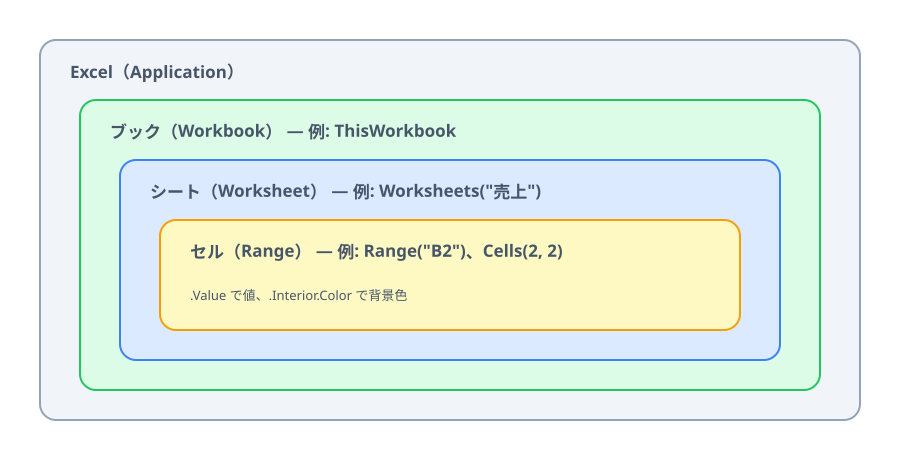

# Excel は部品の入れ子



第 3 章の集計は関数で十分でした。第 4 章では、**関数ではできない操作** を VBA でやってみせます。その前に、VBA から Excel がどう見えているかを整理します。

手元で一緒に動かしたい人は、練習用ブックとデモのコードをダウンロードしてください（見ているだけでも大丈夫です）。

:::download
[練習用ブックとデモのコードをダウンロード](./project.zip)
[サンプルのスプレッドシートをコピー](./spreadsheet)
:::

練習用ブック（Excel は ZIP の `data/sales.xlsm`、スプレッドシートは上のボタンでコピーするサンプル）は第 3 章と同じ売上明細で、金額（F 列）まで埋まっています。Excel のブックにはデモのマクロが入っていて、「売上」シートの右側にはそれを動かすボタンが置いてあります。開くときに [マクロを有効にする](../../00-setup/01-excel/LECTURE.md#ダウンロードしたマクロ入りのブック) 必要があります。

## Excel は部品の入れ子でできている

VBA から見ると、Excel は「部品の中に部品が入っている」構造になっています。

| 部品 | VBA での呼び方 | 例 |
|---|---|---|
| Excel そのもの | `Application` | |
| ブック（ファイル） | `Workbook` | `ThisWorkbook`（このマクロが入っているブック） |
| シート | `Worksheet` | `Worksheets("売上")` |
| セル・範囲 | `Range` | `Range("B2")`、`Cells(2, 2)` |

この部品のことを **オブジェクト** と呼びます。外側から内側へ、`.`（ドット）でたどって指定します。

```vb
ThisWorkbook.Worksheets("売上").Range("B2").Value
```

「このブックの」「売上シートの」「B2 セルの」「値」と読みます。第 2〜3 章で書いた `Range("B2")` は、ブックとシートを省略した書き方で、そのときは **いま開いているシート** が対象になります。

オブジェクトには 2 種類の要素があります。

- **プロパティ** … 部品の状態。読んだり書き換えたりできる（`.Value` 値、`.Name` 名前、`.Interior.Color` 背景色）
- **メソッド** … 部品にさせる動作（`.Copy` コピー、`.Delete` 削除、`.Add` 追加）

:::::platform
::::excel
### デモ: 部品をたどってみる（`ShowObjects`）

`Debug.Print` で、ブックの名前やシートの数をイミディエイト ウィンドウ（`Ctrl` + `G`）に書き出します。

```vb
Debug.Print "ブックの名前: " & ThisWorkbook.Name
Debug.Print "シートの数: " & ThisWorkbook.Worksheets.Count
Debug.Print "売上!B2 の値: " & ThisWorkbook.Worksheets("売上").Range("B2").Value
```
::::
::::sheets
### デモ: 部品をたどってみる（`showObjects`）

スプレッドシートも同じ入れ子です（スプレッドシート → シート → セル）。`console.log` で実行ログに書き出します。

```js
const ss = SpreadsheetApp.getActiveSpreadsheet();
console.log('スプレッドシートの名前: ' + ss.getName());
console.log('シートの数: ' + ss.getSheets().length);
console.log('売上!B2 の値: ' + ss.getSheetByName('売上').getRange('B2').getValue());
```
::::
:::::

ブラウザ上で再現したデモで、何が書き出されるかを見てみましょう。

:::::platform
::::excel
「売上」シートの **ブックの情報を出す** ボタンを押します（「開発」タブ →「マクロ」で `ShowObjects` を選んで「実行」を押しても同じです）。
::::
::::sheets
Apps Script エディタの関数の選択欄で `showObjects` を選び、「▶ 実行」を押します。
::::
:::::

::::sheetdemo[ShowObjects を実行すると、ブックとシートの情報が書き出される]{book="data/sales.xlsx" sheet="売上" macro="ShowObjects"}
log = ブックの名前: sales.xlsm
log = シートの数: 1
log = 1 枚目のシート: 売上
log = 売上!B2 の値: あおば設計事務所
log.sheets = スプレッドシートの名前: sales
log.sheets = シートの数: 1
log.sheets = 1 枚目のシート: 売上
log.sheets = 売上!B2 の値: あおば設計事務所
::::

## シートを変数に入れる（Set）

同じシートを何度も使うときは、変数に入れておくと短く書けます。

:::::platform
::::excel
```vb
Dim salesSheet As Worksheet
Set salesSheet = Worksheets("売上")

salesSheet.Range("A1").Value = "日付"
```

数や文字列ではなく **オブジェクトを変数に入れるときは、先頭に `Set` を付けます**。付け忘れると「オブジェクト変数または With ブロック変数が設定されていません」というエラーになります。よく出るエラーなので覚えておいてください。
::::
::::sheets
```js
const salesSheet = SpreadsheetApp.getActiveSpreadsheet().getSheetByName('売上');

salesSheet.getRange('A1').setValue('日付');
```

GAS では、数や文字列と同じように `const` で入れるだけです。VBA のような `Set` はありません。
::::
:::::

::codeview[この節のデモのコード]

:::faq

### `.` でたどる名前（`Interior.Color` など）を全部覚えないといけませんか？

覚えなくて大丈夫です。VBE では、部品の後ろに `.` を打つと、使えるプロパティとメソッドの候補が一覧で出ます（`Dim salesSheet As Worksheet` のように型を書いた変数だと出やすくなります）。ほかにも、「マクロの記録」で操作を VBA に書き起こしてもらう、AI に聞く、などの調べ方があります。GAS のエディタでも同じように候補が出ます。

### `Set` を付けるかどうか、どう見分ければよいですか？

入れるものが数・文字列・日付なら付けない、`Worksheet` や `Range` のような部品（オブジェクト）なら付ける、です。迷ったら `Dim` の型を見てください。この教材では、`Long` / `String` / `Double` / `Date` には付けない、`Worksheet` には付ける、と覚えれば足ります。

### `ThisWorkbook` と `ActiveWorkbook`、`Worksheets` と `Sheets` は何が違いますか？

`ThisWorkbook` はマクロが入っているブック、`ActiveWorkbook` はいま前面に出ているブックです。複数のブックを開いていると別物になるので、自分のブックを指すなら `ThisWorkbook` が安全です。`Worksheets` は普通のシートだけ、`Sheets` はグラフシートなども含む全シートです。この教材のブックでは、どちらも同じ結果になります。

### 「マクロの記録」で作ったコードには `Select` や `Activate` がたくさん出てきます。書いたほうがよいですか？

書かなくて大丈夫です。記録は人の操作（セルを選ぶ → 値を入れる）をそのままなぞるので `Select` だらけになりますが、`Worksheets("売上").Range("B2").Value = ...` のように部品を直接指せば、選ぶ必要はありません。選ばないほうが速く、画面の状態にも左右されないので、記録したコードは `Select` を消して書き直すのが定番です。

### イミディエイト ウィンドウが見つかりません

VBE の「表示」メニュー →「イミディエイト ウィンドウ」で開きます（Windows は `Ctrl` + `G` でも開きます）。開いたウィンドウは、VBE の下のほうに表示されます。

### 同じシートを何度も書くのが長いです。`With` を使えば短くなりますか？

なります。`With salesSheet` 〜 `End With` の間では、`.Range("A1").Value = ...` のように、先頭の `salesSheet` を省いて書けます。ただし、`With` の入れ子が深くなると、どのオブジェクトを指しているかが読み取りにくくなるので、1 段にとどめるのがおすすめです。GAS には `With` が無いので、この教材のように変数に入れて使います。

:::
