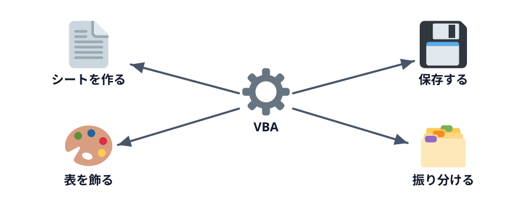

# シートとファイルを操作する



4-1 の続きです。シートを作る、表を飾る、ファイルを保存する。第 5 章の請求書づくりに必要な部品を、講師のデモで一通り見ていきます。

:::download
[練習用ブックとデモのコードをダウンロード](./project.zip)
[サンプルのスプレッドシートをコピー](./spreadsheet)
:::

Excel のブックでは、「売上」シートの右側に、この節のデモ（**表を整える**・**顧客別に分ける**・**増えたシートを消す**・**バックアップを保存**）と 4-1 の **ブックの情報を出す** のボタンが置いてあります。スプレッドシートでは、ZIP の `gas/ObjectDemo.gs` を貼り、Apps Script エディタから実行します。

## デモ 1: 表を飾る（`DecorateSales`）

見出しに色を付け、表に罫線を引き、金額が 5,000 円以上のセルを赤い太字にします。

:::::platform
::::excel
```vb
salesSheet.Range("A1:F1").Interior.Color = RGB(31, 78, 121)
salesSheet.Range("A1:F1").Font.Color = RGB(255, 255, 255)
salesSheet.Range("A1:F" & lastRow).Borders.LineStyle = xlContinuous

For i = 2 To lastRow
    If salesSheet.Cells(i, 6).Value >= 5000 Then
        salesSheet.Cells(i, 6).Font.Color = RGB(192, 0, 0)
        salesSheet.Cells(i, 6).Font.Bold = True
    End If
Next i
```

`RGB(赤, 緑, 青)` は色を 0〜255 の 3 つの数で表します。
::::
::::sheets
```js
salesSheet.getRange('A1:F1').setBackground('#1f4e79').setFontColor('#ffffff');
salesSheet.getRange('A1:F' + lastRow).setBorder(true, true, true, true, true, true);

for (let i = 2; i <= lastRow; i++) {
  const cell = salesSheet.getRange(i, 6);
  if (cell.getValue() >= 5000) {
    cell.setFontColor('#c00000').setFontWeight('bold');
  }
}
```

色は `#` に続く 6 桁（赤・緑・青を 2 桁ずつ）で表します。
::::
:::::

:::notice[それ、条件付き書式でもできます]
「5,000 円以上を赤くする」だけなら、Excel の **条件付き書式** のほうが向いています。値が変われば自動で色も変わるからです。第 3 章の「関数で十分だった」と同じで、VBA は他の機能でできないところに使うのが基本です。
:::

## デモ 2: 顧客ごとにシートを分ける（`SplitByCustomer`）

ここからが関数ではできない操作です。5 社それぞれの名前のシートを作り、その会社の明細だけを書き写します。

:::::platform
::::excel
```vb
For c = 5 To 9
    customerName = salesSheet.Cells(c, 8).Value
    Set customerSheet = Worksheets.Add(After:=Worksheets(Worksheets.Count))
    customerSheet.Name = customerName
    salesSheet.Range("A1:F1").Copy customerSheet.Range("A1")

    outRow = 2
    For i = 2 To lastRow
        If salesSheet.Cells(i, 2).Value = customerName Then
            salesSheet.Range("A" & i & ":F" & i).Copy customerSheet.Range("A" & outRow)
            outRow = outRow + 1
        End If
    Next i
Next c
```

- `Worksheets.Add(After:=...)` … いちばん後ろに新しいシートを足す
- `.Copy 貼り付け先` … 範囲をコピーして貼り付ける
- `outRow` … 書き写し先の次の行。1 行書くたびに 1 増やす

第 3 章の `For` と `If` が、そのまま使われていることに注目してください。
::::
::::sheets
```js
for (let c = 5; c <= 9; c++) {
  const customerName = salesSheet.getRange(c, 8).getValue();
  const customerSheet = ss.insertSheet(customerName, ss.getSheets().length);
  salesSheet.getRange('A1:F1').copyTo(customerSheet.getRange('A1'));

  let outRow = 2;
  for (let i = 2; i <= lastRow; i++) {
    if (salesSheet.getRange(i, 2).getValue() === customerName) {
      salesSheet.getRange('A' + i + ':F' + i).copyTo(customerSheet.getRange('A' + outRow));
      outRow = outRow + 1;
    }
  }
}
```

- `ss.insertSheet(名前, 位置)` … 新しいシートを足す
- `.copyTo(貼り付け先)` … 範囲をコピーして貼り付ける

第 3 章の `for` と `if` が、そのまま使われていることに注目してください。
::::
:::::

ブラウザ上で再現したデモで、シートが増える様子を見てみましょう。

:::::platform
::::excel
「売上」シートの **顧客別に分ける** ボタンを押します（「開発」タブ →「マクロ」で `SplitByCustomer` を選んで「実行」を押しても同じです）。
::::
::::sheets
Apps Script エディタの関数の選択欄で `splitByCustomer` を選び、「▶ 実行」を押します。
::::
:::::

::::sheetdemo[SplitByCustomer を実行すると、顧客ごとのシートが 5 枚増える]{book="data/sales.xlsx" sheet="売上" macro="SplitByCustomer" macros="ShowObjects,DecorateSales,SplitByCustomer,DeleteDemoSheets,SaveBackup"}
tabs = ひまわり商事, あおば設計事務所, みなと物産, さくら学習塾, こもれび珈琲
ひまわり商事!A1:F1 = 日付, 顧客, 商品, 単価, 数量, 金額
ひまわり商事!A2:F2 = 2026/10/07, ひまわり商事, ホッチキス, 680, 2, 1360
ひまわり商事!A3:F3 = 2026/10/07, ひまわり商事, コピー用紙, 550, 3, 1650
ひまわり商事!A4:F4 = 2026/10/08, ひまわり商事, ノート, 180, 2, 360
ひまわり商事!A5:F5 = 2026/10/13, ひまわり商事, コピー用紙, 550, 2, 1100
ひまわり商事!A6:F6 = 2026/10/15, ひまわり商事, ホッチキス, 680, 10, 6800
ひまわり商事!A7:F7 = 2026/10/21, ひまわり商事, ノート, 180, 5, 900
ひまわり商事!A8:F8 = 2026/10/23, ひまわり商事, 付箋, 250, 5, 1250
あおば設計事務所!A1:F1 = 日付, 顧客, 商品, 単価, 数量, 金額
あおば設計事務所!A2:F2 = 2026/10/02, あおば設計事務所, 付箋, 250, 5, 1250
あおば設計事務所!A3:F3 = 2026/10/13, あおば設計事務所, クリアファイル, 60, 1, 60
あおば設計事務所!A4:F4 = 2026/10/14, あおば設計事務所, ホッチキス, 680, 12, 8160
あおば設計事務所!A5:F5 = 2026/10/15, あおば設計事務所, ノート, 180, 10, 1800
あおば設計事務所!A6:F6 = 2026/10/25, あおば設計事務所, 付箋, 250, 1, 250
あおば設計事務所!A7:F7 = 2026/10/28, あおば設計事務所, 修正テープ, 320, 10, 3200
みなと物産!A1:F1 = 日付, 顧客, 商品, 単価, 数量, 金額
みなと物産!A2:F2 = 2026/10/06, みなと物産, 付箋, 250, 10, 2500
みなと物産!A3:F3 = 2026/10/07, みなと物産, ノート, 180, 10, 1800
みなと物産!A4:F4 = 2026/10/08, みなと物産, クリアファイル, 60, 20, 1200
みなと物産!A5:F5 = 2026/10/08, みなと物産, 付箋, 250, 5, 1250
みなと物産!A6:F6 = 2026/10/12, みなと物産, コピー用紙, 550, 20, 11000
みなと物産!A7:F7 = 2026/10/16, みなと物産, コピー用紙, 550, 2, 1100
みなと物産!A8:F8 = 2026/10/17, みなと物産, ボールペン, 120, 5, 600
みなと物産!A9:F9 = 2026/10/22, みなと物産, 付箋, 250, 1, 250
みなと物産!A10:F10 = 2026/10/29, みなと物産, クリアファイル, 60, 20, 1200
さくら学習塾!A1:F1 = 日付, 顧客, 商品, 単価, 数量, 金額
さくら学習塾!A2:F2 = 2026/10/08, さくら学習塾, ホッチキス, 680, 10, 6800
さくら学習塾!A3:F3 = 2026/10/12, さくら学習塾, クリアファイル, 60, 10, 600
さくら学習塾!A4:F4 = 2026/10/19, さくら学習塾, ボールペン, 120, 1, 120
さくら学習塾!A5:F5 = 2026/10/27, さくら学習塾, 付箋, 250, 2, 500
さくら学習塾!A6:F6 = 2026/10/27, さくら学習塾, 付箋, 250, 10, 2500
こもれび珈琲!A1:F1 = 日付, 顧客, 商品, 単価, 数量, 金額
こもれび珈琲!A2:F2 = 2026/10/17, こもれび珈琲, ホッチキス, 680, 12, 8160
こもれび珈琲!A3:F3 = 2026/10/22, こもれび珈琲, ノート, 180, 2, 360
こもれび珈琲!A4:F4 = 2026/10/28, こもれび珈琲, 付箋, 250, 2, 500
::::

### もう一度実行すると…

このマクロをもう一度実行すると、エラーで止まります。「ひまわり商事」というシートがもう存在していて、同じ名前は付けられないからです。

エラーで止まった行と、そのときの `customerName` を確かめてみてください（第 3 章のデバッグと同じ手順です）。やり直すには、「売上」以外のシートを全部消す `DeleteDemoSheets`（Excel では **増えたシートを消す** ボタン）を実行します。

:::::platform
::::excel
```vb
Application.DisplayAlerts = False
For Each ws In Worksheets
    If ws.Name <> "売上" Then
        ws.Delete
    End If
Next ws
Application.DisplayAlerts = True
```

- `For Each ws In Worksheets` 〜 `Next ws` … ブックのシートを 1 枚ずつ `ws` に入れてくり返す。番号ではなく「全部について」くり返したいときの書き方です
- `Application.DisplayAlerts = False` … 「シートを削除しますか？」の確認を出さないようにする。終わったら `True` に戻します
::::
::::sheets
```js
for (const sheet of ss.getSheets()) {
  if (sheet.getName() !== '売上') {
    ss.deleteSheet(sheet);
  }
}
```

- `for (const sheet of ss.getSheets())` … シートを 1 枚ずつ `sheet` に入れてくり返す。番号ではなく「全部について」くり返したいときの書き方です
::::
:::::

## デモ 3: ファイルを保存する（`SaveBackup`）

日時入りの名前で、ブックのコピーを保存します。毎月の締めの前にバックアップを取る、といった使い方ができます。

:::::platform
::::excel
```vb
fileName = ThisWorkbook.Path & Application.PathSeparator & _
    "売上_バックアップ_" & Format(Now, "yyyymmdd_hhnnss") & ".xlsm"
ThisWorkbook.SaveCopyAs fileName
```

- `ThisWorkbook.Path` … このブックが保存されているフォルダ
- `Application.PathSeparator` … フォルダの区切り文字（Windows は `\`、Mac は `/`）
- 行末の ` _` … 長い行を途中で折り返す記号
::::
::::sheets
```js
const stamp = Utilities.formatDate(new Date(), Session.getScriptTimeZone(), 'yyyyMMdd_HHmmss');
DriveApp.getFileById(ss.getId()).makeCopy('売上_バックアップ_' + stamp);
```

コピーは Google ドライブに保存されます。ドライブを操作するので、初回は追加の承認を求められます。
::::
:::::

## 帳票づくりにつなげる

ここまでの部品を組み合わせると、月末の請求書づくりがほぼ書けます。

| 請求書づくりの手順 | 使う部品 | 出てきた章 |
|---|---|---|
| 顧客を 1 社ずつ処理する | `For` | 3 |
| 請求書のひな形をコピーする | シートの `.Copy` | 4 |
| 宛名を書く | `Range(...).Value` | 2 |
| その顧客の明細だけを書き写す | `For` と `If` | 3・4 |
| PDF にする | シートの `.ExportAsFixedFormat` | 5 |
| ボタン（メニュー）で実行する | ボタンへのマクロの登録（GAS は `onOpen` のメニュー） | 5 |

## どの道具を使うか

| やりたいこと | まず考える道具 |
|---|---|
| 値を計算する・集計する | 関数（SUM、SUMIF など） |
| 条件によって見た目を変える | 条件付き書式 |
| 条件に合う行だけを見る | フィルター、FILTER 関数 |
| シートやファイルを作る・消す・保存する | VBA |
| 毎回同じ手順の操作をまとめて実行する | VBA |

VBA は強力ですが、関数や標準の機能で済むなら、そのほうが誰にでも分かりやすく、壊れにくい仕組みになります。

::codeview[この節のデモのコード]

:::faq

### `DeleteDemoSheets` で消したシートを元に戻せますか？

戻せません。マクロの実行結果は `Ctrl` + `Z` で戻せず、しかも `Application.DisplayAlerts = False` で確認も出さずに消しています。試す前にブックを保存しておけば、保存せずに閉じて開き直すことで戻せます。スプレッドシートは「ファイル」→「変更履歴」から戻せます。

### 使いたい色の `RGB` の数値はどうやって調べますか？

Excel の「ホーム」→ 塗りつぶしの色 →「その他の色」→「ユーザー設定」で色を選ぶと、赤・緑・青の数値が表示されます。GAS で使う `#1f4e79` のような書き方は、赤・緑・青を 16 進数 2 桁ずつで並べたもので、`RGB(31, 78, 121)` と同じ色です。

### シートがもうあるかどうかを確かめてから作ることはできますか？

できます。VBA なら `For Each` でシートを 1 枚ずつ見て、同じ名前のシートがあるかを調べます。GAS なら `ss.getSheetByName(名前)` が、無いときに `null` を返すので、それで判定できます。この教材では「作る前に前回の分を全部消す」方針（5-2）にしています。毎回同じ状態から作り直せるので、途中まで作られたシートが残る心配がありません。

### 顧客名によっては、シート名にできないことはありますか？

あります。Excel のシート名は 31 文字までで、`:` `\` `/` `?` `*` `[` `]` は使えません。長い会社名や `/` を含む名前だとエラーになるので、実務では名前を切り詰めたり、記号を置き換えたりしてから付けます。

### 色を付けたセルを、元の色（塗りつぶしなし）に戻したいです

VBA では `Range("A1:F1").Interior.ColorIndex = xlNone`、GAS では `getRange('A1:F1').setBackground(null)` で塗りつぶしを消せます。文字色を戻すには、VBA は `.Font.ColorIndex = xlAutomatic`、GAS は `.setFontColor(null)` です。

### シートをたくさん作ると、画面がちらついて遅くなります

VBA では、処理の最初に `Application.ScreenUpdating = False` を書いて画面の更新を止め、最後に `True` に戻すと、ちらつきが消えて速くなります。途中でエラーになっても `True` に戻るよう、エラー処理と組み合わせるのが安全です。GAS はサーバーで動くので画面のちらつきはありませんが、セルを 1 つずつではなく `getValues` / `setValues` でまとめて読み書きすると、ずっと速くなります。

:::
