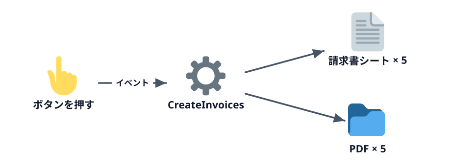
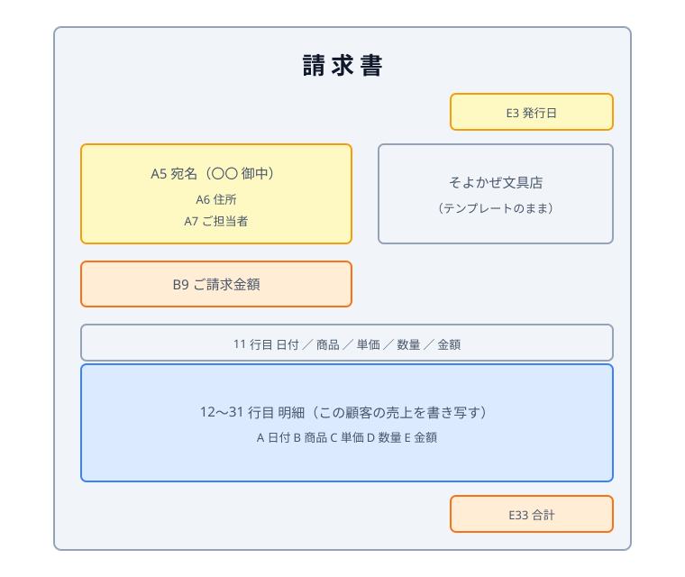

# テンプレートをコピーして宛名を書く



月末作業の残り、「顧客ごとに請求書を作って PDF にする」を自動化します。第 5 章の最後には、ボタンを置いて **押すだけで 5 社分の請求書ができる** 状態にします。第 3 章の `For` と `If`、第 4 章のシート操作を組み合わせるだけで書けます。

**この章の完成条件:** ボタンを押すと、顧客ごとの請求書シートと PDF ができる。

この節では、まず 1 社分の請求書シートを作って宛名を書くところまで進めます。

## 準備

:::download
[練習用ブックをダウンロード](./start.zip)
:::

:::::platform
::::excel
1. `data/invoice.xlsx` を Excel で開き、**Excel マクロ有効ブック（\*.xlsm）** として保存する。PDF はこのブックと同じフォルダにできるので、デスクトップなど分かりやすい場所に保存してください
2. `Alt` + `F11` で VBE を開き、「挿入」→「標準モジュール」
::::
::::sheets
1. `data/invoice.xlsx` を Google ドライブにアップロードして開き、「ファイル」→「Google スプレッドシートとして保存」。PDF はこのスプレッドシートと同じフォルダにできます
2. 「拡張機能」→「Apps Script」
::::
:::::

ブックには 3 枚のシートがあります。

| シート | 中身 |
|---|---|
| 売上 | 第 3 章と同じ 10 月の明細（金額まで埋まっている） |
| 顧客 | 5 社の顧客名・郵便番号・住所・ご担当者 |
| 請求書テンプレート | 請求書のひな形。マクロはこれをコピーして値を埋める |

請求書テンプレートのどのセルに何を書くかは、次のとおりです。



| セル | 書くもの | どこから |
|---|---|---|
| E3 | 発行日 | 今日の日付 |
| A5 / A6 / A7 | 宛名 / 住所 / ご担当者 | 顧客シートの 1 行 |
| A12:E31 | 明細（日付・商品・単価・数量・金額） | 売上シートのうち、その顧客の行 |
| E33 と B9 | 合計 / ご請求金額 | 明細の金額の合計 |

## 1 社分の請求書シートを作る

まずは顧客シートの 2 行目（ひまわり商事）だけで考えます。テンプレートをコピーして名前を付け、宛名を書きます。

:::::platform
::::excel
```vb
Sub CreateInvoices()
    Dim salesSheet As Worksheet
    Dim customerSheet As Worksheet
    Dim invoiceSheet As Worksheet
    Dim c As Long
    Dim customerName As String

    Set salesSheet = Worksheets("売上")
    Set customerSheet = Worksheets("顧客")

    c = 2
    customerName = customerSheet.Cells(c, 1).Value

    ' テンプレートを末尾にコピーして名前を付ける
    Worksheets("請求書テンプレート").Copy After:=Worksheets(Worksheets.Count)
    Set invoiceSheet = Worksheets(Worksheets.Count)
    invoiceSheet.Name = "請求書_" & customerName

    ' 宛名と発行日
    invoiceSheet.Range("A5").Value = customerName & " 御中"
    invoiceSheet.Range("A6").Value = customerSheet.Cells(c, 2).Value & " " & customerSheet.Cells(c, 3).Value
    invoiceSheet.Range("A7").Value = customerSheet.Cells(c, 4).Value
    invoiceSheet.Range("E3").Value = Date
End Sub
```

- `.Copy After:=Worksheets(Worksheets.Count)` … いちばん後ろの後ろ、つまり末尾にコピーする
- `Set invoiceSheet = Worksheets(Worksheets.Count)` … 末尾のシート（いまコピーしたもの）に `invoiceSheet` という名前を付ける
- `Date` … 今日の日付
::::
::::sheets
```js
function createInvoices() {
  const ss = SpreadsheetApp.getActiveSpreadsheet();
  const salesSheet = ss.getSheetByName('売上');
  const customerSheet = ss.getSheetByName('顧客');

  const c = 2;
  const customerName = customerSheet.getRange(c, 1).getValue();

  // テンプレートを末尾にコピーして名前を付ける
  const invoiceSheet = ss.getSheetByName('請求書テンプレート').copyTo(ss);
  invoiceSheet.setName('請求書_' + customerName);

  // 宛名と発行日
  invoiceSheet.getRange('A5').setValue(customerName + ' 御中');
  invoiceSheet.getRange('A6').setValue(customerSheet.getRange(c, 2).getValue() + ' ' + customerSheet.getRange(c, 3).getValue());
  invoiceSheet.getRange('A7').setValue(customerSheet.getRange(c, 4).getValue());
  invoiceSheet.getRange('E3').setValue(new Date());
}
```

- `.copyTo(ss)` … シートを同じスプレッドシートの末尾にコピーして、コピーしたシートを返す
- `new Date()` … 今の日時
::::
:::::

実行すると「請求書_ひまわり商事」シートができ、宛名が入ります。ブラウザ上で再現したデモでも試せます。

:::::platform
::::excel
「開発」タブの「マクロ」を押し、一覧から `CreateInvoices` を選んで「実行」を押します。
::::
::::sheets
Apps Script エディタの関数の選択欄で `createInvoices` を選び、「▶ 実行」を押します。
::::
:::::

::::sheetdemo[CreateInvoices を実行すると、請求書_ひまわり商事 シートができて宛名が入る]{book="data/invoice.xlsx" sheet="請求書テンプレート" macro="CreateInvoices" openTab="added"}
tabs = 請求書_ひまわり商事 <- 請求書テンプレート
請求書_ひまわり商事!A5 = ひまわり商事 御中
請求書_ひまわり商事!A6 = 〒104-0000 東京都中央区ひまわり 2-4-6
請求書_ひまわり商事!A7 = 総務部 山田 様
請求書_ひまわり商事!E3 = 2026/10/31
::::

確認したら、このシートは手で削除しておいてください（同じ名前のシートがあると次の実行がエラーになります）。

::codeview[この節の完成コード]

:::faq

### `'` で始まる緑色の行は何ですか？

**コメント** です。`'` から行の終わりまでは、実行されないメモとして扱われます（GAS では `//`）。何をしているかではなく、「なぜそうしているか」を残すのに使います。

### 「その名前はすでに使用されています」というエラーが出ます

前に実行したときの「請求書_ひまわり商事」シートが残っています。シートのタブを右クリック →「削除」で消してから、もう一度実行してください。5-2 で、実行のたびに自動で消すようにします。

### `.Copy` のあとに、なぜ `Worksheets(Worksheets.Count)` でシートを取り直すのですか？

VBA の `Worksheet.Copy` は、コピーしてできたシートを返してくれないからです（GAS の `copyTo` は返してくれます）。末尾にコピーしたので、「末尾のシート」で取り直しています。コピーした直後は新しいシートが選ばれた状態になるので `ActiveSheet` でも取れますが、画面の状態に頼らない書き方にしています。

### テンプレートのシートを、利用者から隠しておけますか？

隠せます。シートのタブを右クリック →「非表示」にしても、マクロからはコピーできます。ただし、非表示のシートをコピーするとコピーも非表示になるので、`invoiceSheet.Visible = xlSheetVisible` を足して表示させます。GAS では `hideSheet()` で隠し、コピーしたシートに `showSheet()` を呼んで表示させます。

### 発行日が `2026/10/31` ではなく `46326` のような数字になります

Excel の日付は、内部では「1900 年 1 月 1 日から何日目か」という数で持っています。書き込んだセルの表示形式が日付になっていないと、その数のまま表示されます。テンプレートの E3 は日付の表示形式にしてあるので、別のセルに書いていないかを確かめてください。表示形式は VBA の `Range("E3").NumberFormat = "yyyy/mm/dd"`、GAS の `setNumberFormat('yyyy/mm/dd')` でも設定できます。

### シートを名前（`Worksheets("請求書テンプレート")`）で指していると、名前を変えられたら動かなくなりませんか？

そのとおりです。VBA では、VBE のプロパティ ウィンドウでシートの `(Name)`（コード名）を `shTemplate` のように付けておき、コードでは `shTemplate.Copy ...` と書くと、シート見出しの名前を変えられても動きます。GAS では、名前の代わりにシートの ID（`getSheetId()`）で探す方法があります。

:::
