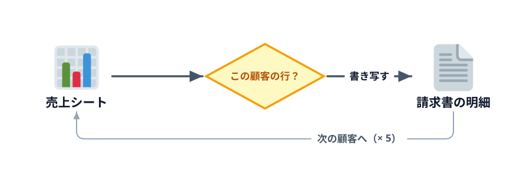

# 明細を書き写す



5-1 の続きです。5-1 のブックとモジュールをそのまま使います。

:::download
[この節を始めるブックをダウンロード](./start.zip)
[サンプルのスプレッドシートをコピー](./spreadsheet)
:::

前の節から続けている人は、そのブックのまま進めてください。ここから始める人は、上のボタンから 5-1（テンプレートをコピーして宛名を書く）を終えた状態のブックをダウンロードしてください。Excel では、マクロ入りのブック（`.xlsm`）を開くときに [マクロを有効にする](../../00-setup/01-excel/LECTURE.md#ダウンロードしたマクロ入りのブック) 必要があります。スプレッドシートでは、上の「サンプルのスプレッドシートをコピー」で自分のドライブにコピーを作り、「コードをダウンロード」の ZIP にある `gas/` のコードを Apps Script エディタに貼って、前の節を終えた状態にしてから進めてください。

売上シートからその顧客の明細だけを請求書に書き写し、1 社分を 5 社分に広げます。

## 明細を書き写す

売上シートを上から順に見て、顧客名が一致する行だけを請求書の 12 行目から書き写します。第 3 章の `SumByCustomer` とほぼ同じ形です。違うのは、足すだけでなく **書き写す** ことと、書き写し先の行 `lineRow` を 1 つずつ下げていくことです。

**書く場所:** 5-1 の「宛名と発行日」のあと、`End Sub`（GAS は最後の `}`）の前

:::::platform
::::excel
```vb
    ' 売上からこの顧客の行だけを明細に転記する
    lineRow = 12
    total = 0
    For i = 2 To lastSalesRow
        If salesSheet.Cells(i, 2).Value = customerName Then
            invoiceSheet.Cells(lineRow, 1).Value = salesSheet.Cells(i, 1).Value
            invoiceSheet.Cells(lineRow, 2).Value = salesSheet.Cells(i, 3).Value
            invoiceSheet.Cells(lineRow, 3).Value = salesSheet.Cells(i, 4).Value
            invoiceSheet.Cells(lineRow, 4).Value = salesSheet.Cells(i, 5).Value
            invoiceSheet.Cells(lineRow, 5).Value = salesSheet.Cells(i, 6).Value
            total = total + salesSheet.Cells(i, 6).Value
            lineRow = lineRow + 1
        End If
    Next i
    invoiceSheet.Range("E33").Value = total
    invoiceSheet.Range("B9").Value = total
```

新しい変数を使うので、`Sub` の先頭の `Dim` に次を足し、`lastSalesRow` を求める行も足します。

```vb
    Dim lastSalesRow As Long
    Dim i As Long
    Dim lineRow As Long
    Dim total As Long
```

```vb
    lastSalesRow = salesSheet.Cells(salesSheet.Rows.Count, 1).End(xlUp).Row
```
::::
::::sheets
```js
  // 売上からこの顧客の行だけを明細に転記する
  const lastSalesRow = salesSheet.getLastRow();
  let lineRow = 12;
  let total = 0;
  for (let i = 2; i <= lastSalesRow; i++) {
    if (salesSheet.getRange(i, 2).getValue() === customerName) {
      invoiceSheet.getRange(lineRow, 1).setValue(salesSheet.getRange(i, 1).getValue());
      invoiceSheet.getRange(lineRow, 2).setValue(salesSheet.getRange(i, 3).getValue());
      invoiceSheet.getRange(lineRow, 3).setValue(salesSheet.getRange(i, 4).getValue());
      invoiceSheet.getRange(lineRow, 4).setValue(salesSheet.getRange(i, 5).getValue());
      invoiceSheet.getRange(lineRow, 5).setValue(salesSheet.getRange(i, 6).getValue());
      total = total + salesSheet.getRange(i, 6).getValue();
      lineRow = lineRow + 1;
    }
  }
  invoiceSheet.getRange('E33').setValue(total);
  invoiceSheet.getRange('B9').setValue(total);
```
::::
:::::

売上シートの列（A 日付・C 商品・D 単価・E 数量・F 金額）と、請求書の列（A 日付・B 商品・C 単価・D 数量・E 金額）はずれています。顧客名（売上の B 列）は請求書の明細には書かないからです。

ひまわり商事の請求書に 7 行の明細が入り、ご請求金額が **¥13,420** になれば成功です。

:::::platform
::::excel
「顧客」シートの **請求書を作る** ボタンを押します（「開発」タブ →「マクロ」で `CreateInvoices` を選んで「実行」を押しても同じです）。
::::
::::sheets
メニューの「請求書」→「請求書を作る」を押します（Apps Script エディタの関数の選択欄で `createInvoices` を選んで「▶ 実行」を押しても同じです）。
::::
:::::

::::sheetdemo[CreateInvoices を実行すると、ひまわり商事の明細と合計が入る]{book="data/invoice.xlsx" menu="請求書" sheet="顧客" macro="CreateInvoices" openTab="added"}
tabs = 請求書_ひまわり商事 <- 請求書テンプレート
請求書_ひまわり商事!A5 = ひまわり商事 御中
請求書_ひまわり商事!A6 = 〒104-0000 東京都中央区ひまわり 2-4-6
請求書_ひまわり商事!A7 = 総務部 山田 様
請求書_ひまわり商事!E3 = 2026/10/31
請求書_ひまわり商事!A12:E12 = 2026/10/07, ホッチキス, 680, 2, 1360
請求書_ひまわり商事!A13:E13 = 2026/10/07, コピー用紙, 550, 3, 1650
請求書_ひまわり商事!A14:E14 = 2026/10/08, ノート, 180, 2, 360
請求書_ひまわり商事!A15:E15 = 2026/10/13, コピー用紙, 550, 2, 1100
請求書_ひまわり商事!A16:E16 = 2026/10/15, ホッチキス, 680, 10, 6800
請求書_ひまわり商事!A17:E17 = 2026/10/21, ノート, 180, 5, 900
請求書_ひまわり商事!A18:E18 = 2026/10/23, 付箋, 250, 5, 1250
請求書_ひまわり商事!E33 = 13420
請求書_ひまわり商事!B9 = 13420
::::

第 3 章の顧客別合計と一致しています。

:::notice[うまくいかないときはデバッガー]
明細が 1 行も入らないときは、`If` の行にブレークポイントを置いて、`salesSheet.Cells(i, 2).Value` と `customerName` を見比べてください。顧客名の前後に余計なスペースがあると「一致しない」と判定されます。
:::

## 全顧客分をくり返す

`c = 2` で 1 社だけにしていたところを、顧客シートの 2 行目から最後の行までの **くり返し** に変えます。

:::::platform
::::excel
```vb
    lastCustomerRow = customerSheet.Cells(customerSheet.Rows.Count, 1).End(xlUp).Row

    For c = 2 To lastCustomerRow
        customerName = customerSheet.Cells(c, 1).Value
        ' …5-1 とこの節で書いた、コピー〜合計までの行…
    Next c
```

`Dim lastCustomerRow As Long` も足してください。`For c` の中に、明細をくり返す `For i` が入る形になります（第 3 章のチャレンジと同じ「くり返しの中のくり返し」です）。
::::
::::sheets
```js
  const lastCustomerRow = customerSheet.getLastRow();

  for (let c = 2; c <= lastCustomerRow; c++) {
    const customerName = customerSheet.getRange(c, 1).getValue();
    // …5-1 とこの節で書いた、コピー〜合計までの行…
  }
```

`for (let c ...)` の中に、明細をくり返す `for (let i ...)` が入る形になります（第 3 章のチャレンジと同じ「くり返しの中のくり返し」です）。
::::
:::::

実行すると、5 社分の請求書シートができます。

:::::platform
::::excel
「顧客」シートの **請求書を作る** ボタンを押します（「開発」タブ →「マクロ」で `CreateInvoices` を選んで「実行」を押しても同じです）。
::::
::::sheets
メニューの「請求書」→「請求書を作る」を押します（Apps Script エディタの関数の選択欄で `createInvoices` を選んで「▶ 実行」を押しても同じです）。
::::
:::::

::::sheetdemo[CreateInvoices を実行すると、5 社分の請求書シートができる]{book="data/invoice.xlsx" menu="請求書" sheet="顧客" macro="CreateInvoices" macros="CreateInvoices,DeleteInvoices"}
tabs = 請求書_ひまわり商事 <- 請求書テンプレート, 請求書_あおば設計事務所 <- 請求書テンプレート, 請求書_みなと物産 <- 請求書テンプレート, 請求書_さくら学習塾 <- 請求書テンプレート, 請求書_こもれび珈琲 <- 請求書テンプレート
請求書_ひまわり商事!A5 = ひまわり商事 御中
請求書_ひまわり商事!A6 = 〒104-0000 東京都中央区ひまわり 2-4-6
請求書_ひまわり商事!A7 = 総務部 山田 様
請求書_ひまわり商事!E3 = 2026/10/31
請求書_ひまわり商事!A12:E12 = 2026/10/07, ホッチキス, 680, 2, 1360
請求書_ひまわり商事!A13:E13 = 2026/10/07, コピー用紙, 550, 3, 1650
請求書_ひまわり商事!A14:E14 = 2026/10/08, ノート, 180, 2, 360
請求書_ひまわり商事!A15:E15 = 2026/10/13, コピー用紙, 550, 2, 1100
請求書_ひまわり商事!A16:E16 = 2026/10/15, ホッチキス, 680, 10, 6800
請求書_ひまわり商事!A17:E17 = 2026/10/21, ノート, 180, 5, 900
請求書_ひまわり商事!A18:E18 = 2026/10/23, 付箋, 250, 5, 1250
請求書_ひまわり商事!E33 = 13420
請求書_ひまわり商事!B9 = 13420
請求書_あおば設計事務所!A5 = あおば設計事務所 御中
請求書_あおば設計事務所!A6 = 〒160-0000 東京都新宿区あおば台 3-1-8
請求書_あおば設計事務所!A7 = 事務担当 佐藤 様
請求書_あおば設計事務所!E3 = 2026/10/31
請求書_あおば設計事務所!A12:E12 = 2026/10/02, 付箋, 250, 5, 1250
請求書_あおば設計事務所!A13:E13 = 2026/10/13, クリアファイル, 60, 1, 60
請求書_あおば設計事務所!A14:E14 = 2026/10/14, ホッチキス, 680, 12, 8160
請求書_あおば設計事務所!A15:E15 = 2026/10/15, ノート, 180, 10, 1800
請求書_あおば設計事務所!A16:E16 = 2026/10/25, 付箋, 250, 1, 250
請求書_あおば設計事務所!A17:E17 = 2026/10/28, 修正テープ, 320, 10, 3200
請求書_あおば設計事務所!E33 = 14720
請求書_あおば設計事務所!B9 = 14720
請求書_みなと物産!A5 = みなと物産 御中
請求書_みなと物産!A6 = 〒231-0000 神奈川県横浜市中区みなと 5-5-1
請求書_みなと物産!A7 = 経理部 鈴木 様
請求書_みなと物産!E3 = 2026/10/31
請求書_みなと物産!A12:E12 = 2026/10/06, 付箋, 250, 10, 2500
請求書_みなと物産!A13:E13 = 2026/10/07, ノート, 180, 10, 1800
請求書_みなと物産!A14:E14 = 2026/10/08, クリアファイル, 60, 20, 1200
請求書_みなと物産!A15:E15 = 2026/10/08, 付箋, 250, 5, 1250
請求書_みなと物産!A16:E16 = 2026/10/12, コピー用紙, 550, 20, 11000
請求書_みなと物産!A17:E17 = 2026/10/16, コピー用紙, 550, 2, 1100
請求書_みなと物産!A18:E18 = 2026/10/17, ボールペン, 120, 5, 600
請求書_みなと物産!A19:E19 = 2026/10/22, 付箋, 250, 1, 250
請求書_みなと物産!A20:E20 = 2026/10/29, クリアファイル, 60, 20, 1200
請求書_みなと物産!E33 = 20900
請求書_みなと物産!B9 = 20900
請求書_さくら学習塾!A5 = さくら学習塾 御中
請求書_さくら学習塾!A6 = 〒180-0000 東京都武蔵野市さくら通り 1-9
請求書_さくら学習塾!A7 = 教室長 高橋 様
請求書_さくら学習塾!E3 = 2026/10/31
請求書_さくら学習塾!A12:E12 = 2026/10/08, ホッチキス, 680, 10, 6800
請求書_さくら学習塾!A13:E13 = 2026/10/12, クリアファイル, 60, 10, 600
請求書_さくら学習塾!A14:E14 = 2026/10/19, ボールペン, 120, 1, 120
請求書_さくら学習塾!A15:E15 = 2026/10/27, 付箋, 250, 2, 500
請求書_さくら学習塾!A16:E16 = 2026/10/27, 付箋, 250, 10, 2500
請求書_さくら学習塾!E33 = 10520
請求書_さくら学習塾!B9 = 10520
請求書_こもれび珈琲!A5 = こもれび珈琲 御中
請求書_こもれび珈琲!A6 = 〒154-0000 東京都世田谷区こもれび 7-2-10
請求書_こもれび珈琲!A7 = 店長 田中 様
請求書_こもれび珈琲!E3 = 2026/10/31
請求書_こもれび珈琲!A12:E12 = 2026/10/17, ホッチキス, 680, 12, 8160
請求書_こもれび珈琲!A13:E13 = 2026/10/22, ノート, 180, 2, 360
請求書_こもれび珈琲!A14:E14 = 2026/10/28, 付箋, 250, 2, 500
請求書_こもれび珈琲!E33 = 9020
請求書_こもれび珈琲!B9 = 9020
msgbox = 5 件の請求書を作りました
::::

### 何度実行しても大丈夫にする

もう一度実行すると「その名前はすでに使用されています」というエラーになります。そこで、作る前に前回の請求書シートを消す `DeleteInvoices` を用意して、最初に呼びます。

:::::platform
::::excel
```vb
Sub DeleteInvoices()
    Dim ws As Worksheet

    Application.DisplayAlerts = False
    For Each ws In Worksheets
        If Left(ws.Name, 4) = "請求書_" Then
            ws.Delete
        End If
    Next ws
    Application.DisplayAlerts = True
End Sub
```

`Left(ws.Name, 4)` はシート名の左から 4 文字です。「請求書テンプレート」は消さずに、「請求書_」で始まるシートだけを消します。

`CreateInvoices` の `Dim` のあとに `DeleteInvoices` と 1 行書くと、そこでこのマクロが呼ばれます。
::::
::::sheets
```js
function deleteInvoices() {
  const ss = SpreadsheetApp.getActiveSpreadsheet();
  for (const sheet of ss.getSheets()) {
    if (sheet.getName().startsWith('請求書_')) {
      ss.deleteSheet(sheet);
    }
  }
}
```

`startsWith('請求書_')` は「請求書_ で始まるか」です。「請求書テンプレート」は消さずに、「請求書_」で始まるシートだけを消します。

`createInvoices` の最初に `deleteInvoices();` と 1 行書くと、そこでこの関数が呼ばれます。
::::
:::::

::codeview[この節の完成コード]

:::faq

### 2 社目以降の請求書の合計がおかしい、前の会社の明細が混ざります

`lineRow = 12` と `total = 0` が `For c`（GAS は `for (let c ...)`）の **中** にあるか確かめてください。くり返しの外に置くと、2 社目は 1 社目の続きの行から書き始め、合計も前の会社の分に足されていきます。「1 社ごとに最初からやり直すもの」は、くり返しの中で初期化するのが原則です。

### `Left(ws.Name, 4)` の `4` はどこから来たのですか？

「請求書_」の文字数です（請・求・書・_ の 4 文字）。VBA の `Left` は、全角も半角も 1 文字として数えます。比べる文字列を変えたら、この数も合わせて直す必要があります。`ws.Name Like "請求書_*"` と書けば、文字数を数えずに済みます。

### `DeleteInvoices` を `Call DeleteInvoices` と書いても同じですか？

同じです。`Call` は付けても付けなくても動きます。引数を渡すマクロでは、`Call` を付けるときは引数を `( )` で囲み、付けないときは囲まない、という違いがあります。また、`Private Sub DeleteInvoices()` にすると「マクロ」の一覧に出なくなり、利用者が単独で実行してしまうのを防げます（同じモジュールの `CreateInvoices` からは呼べます）。

### 顧客ごとに売上を全行見直すのは、無駄ではありませんか？

5 社 × 30 行 = 150 回の比較なので、この規模なら一瞬です。顧客が数百社、明細が数万行になると効いてくるので、そのときは「売上を顧客順に並べ替えてから一度だけ上から見る」「`Scripting.Dictionary`（Windows のみ）や GAS の `Map` で、顧客ごとに明細を先に振り分けておく」などに切り替えます。まずは読みやすい二重のくり返しで正しく動かし、遅くなってから直すのが順番です。

### `For c` と `For i` が入れ子になっていて、どちらの `Next` が先に来るのか分かりません

内側のくり返しが先に閉じます。`For c` の中で `For i` が始まるので、まず `Next i` で明細のくり返しを閉じ、そのあとに `Next c` で顧客のくり返しを閉じます。インデント（字下げ）をそろえておくと、どの `For` とどの `Next` が組かが見て分かります。

### 明細が 20 行を超える顧客がいたら、どうなりますか？

テンプレートの明細欄は 12〜31 行目なので、21 行目以降は 32 行目より下に書かれ、33 行目の合計欄を上書きしてしまいます。明細の件数を先に数えて 20 件を超えたら知らせる、`Rows(lineRow).Insert` で行を足す、2 枚目の請求書を作る、といった対応が必要です（5-3 の「発展」でも取り上げています）。

:::
