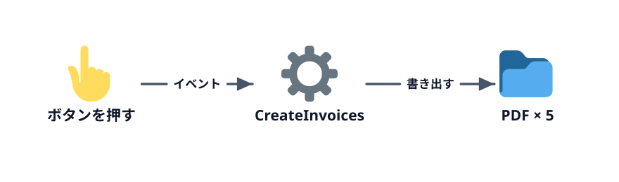

# PDF にしてボタンから実行する



5-2 の続きです。請求書を PDF にし、最後にボタンを置いて、VBE やエディタを開かなくても実行できるようにします。

## PDF にする

`Next c`（GAS は `for` の閉じ `}`）の直前、合計を書いたあとに、請求書シートを PDF にする処理を足します。

:::::platform
::::excel
```vb
        ' ブックと同じフォルダに PDF を書き出す
        pdfPath = ThisWorkbook.Path & Application.PathSeparator & "請求書_" & customerName & ".pdf"
        invoiceSheet.ExportAsFixedFormat Type:=xlTypePDF, Filename:=pdfPath
```

`Dim pdfPath As String` も足します。実行すると、ブックと同じフォルダに 5 つの PDF ができます。

:::warning[PDF が保存できないときは]
- **OneDrive に保存したブック** では `ThisWorkbook.Path` が `https://…` になり、PDF を書き出せないことがあります。ブックをデスクトップなど PC の中のフォルダに保存し直してください
- **Mac** では、初回に「フォルダへのアクセスを許可しますか」と聞かれます。「アクセスを許可」を押してください
:::
::::
::::sheets
Apps Script には Excel の `ExportAsFixedFormat` にあたる命令がありません。そこで、スプレッドシートの「ファイル」→「ダウンロード」→「PDF」と同じ URL を呼び出して PDF を受け取り、ドライブに保存する関数 `savePdf_` を用意します。

```js
function savePdf_(ss, sheet) {
  const url = 'https://docs.google.com/spreadsheets/d/' + ss.getId() + '/export' +
    '?format=pdf&size=A4&portrait=true&fitw=true&gridlines=false&gid=' + sheet.getSheetId();
  const response = UrlFetchApp.fetch(url, {
    headers: { Authorization: 'Bearer ' + ScriptApp.getOAuthToken() },
  });
  const folder = DriveApp.getFileById(ss.getId()).getParents().next();
  folder.createFile(response.getBlob().setName(sheet.getName() + '.pdf'));
}
```

この中身は理解できなくても大丈夫です。「シートを渡すと PDF にしてくれる部品」として使います（関数名の末尾の `_` は、実行する関数の一覧に出さないための Apps Script の決まりです）。

`createInvoices` の合計を書いたあとに、次の 2 行を足します。

```js
    SpreadsheetApp.flush();
    savePdf_(ss, invoiceSheet);
```

`SpreadsheetApp.flush()` は、ここまでの書き込みを確定させる命令です。これが無いと、書き込む前の空の請求書が PDF になることがあります。

初回はドライブと外部への接続の承認を求められます。
::::
:::::

## ボタンから実行する

最後に、VBE やエディタを開かなくても実行できるよう、シートにボタンを置きます。

:::::platform
::::excel
1. 「顧客」シートを開く
2. 「開発」タブ →「挿入」→ フォーム コントロールの **ボタン** を選び、シートの空いているところをドラッグする
3. 「マクロの登録」が開くので `CreateInvoices` を選んで「OK」
4. ボタンを右クリック →「テキストの編集」で「請求書を作る」に変える
5. セルをクリックしてボタンの選択を外してから、ボタンを押す
::::
::::sheets
1. 「顧客」シートを開く
2. 「挿入」→「図形描画」で、四角形を描いて「請求書を作る」と文字を入れ、「保存して終了」
3. 図形をクリックし、右上の **︙** →「スクリプトを割り当て」に `createInvoices` と入力して「確定」
4. 図形を押す

完成コードには `onOpen` も入っています。スプレッドシートを開き直すと、メニューに「請求書」→「請求書を作る」が出て、そこからも実行できます。`onOpen` は名前で決まった特別な関数で、スプレッドシートを開いたときに自動で動きます。
::::
:::::

「ボタンを押す」のように、利用者の操作をきっかけにマクロを動かす仕組みを **イベント** と呼びます。ここでやったのは「ボタンが押されたら `CreateInvoices` を動かす」という登録です。`Sub`（GAS は `function`）は単独でも、ボタンからでも、ほかのマクロからでも動かせる「手順のかたまり」です。

:::notice[マクロのボタンを配るときは]
ボタンを押す人は、マクロの中身を読まずに実行します。人に渡すブックでは、ボタンを押すと何が起きるか（シートが消える、ファイルができる など）をボタンの近くに書いておきましょう。
:::

## 完成チェック

- [ ] ボタンを押すと、5 社分の「請求書_〇〇」シートができる
- [ ] 各請求書の明細とご請求金額が、第 3 章の顧客別合計と一致する
- [ ] ブック（スプレッドシート）と同じフォルダに、5 つの PDF ができる
- [ ] もう一度ボタンを押しても、エラーにならずに作り直される

これで、第 1 章の月末作業はすべてボタンひとつで終わるようになりました。第 1 回のハンズオンはここまでです。取引先が 50 社に増えても、押す回数は 1 回のままです。

## 発展（持ち帰り）

- **請求月を選べるようにする** — 顧客シートの空いたセルに「2026/10」のように月を書き、その月の明細だけを請求書にする（ヒント: `If` の条件に日付の比較を足す。`Month(日付)` で月が取れます）
- **明細が 20 行を超えたら** — テンプレートの明細欄は 20 行です。超えたときにどうするか（エラーにする、2 ページ目を作る）を考えて実装する
- **メールで送る** — 作った PDF を顧客に送るところまで自動化する。Excel なら Outlook、スプレッドシートなら `GmailApp` を使います。ただし誤送信は取り返しがつかないので、まず「下書きを作る」までにするのがおすすめです

::codeview[この章の完成コード]
