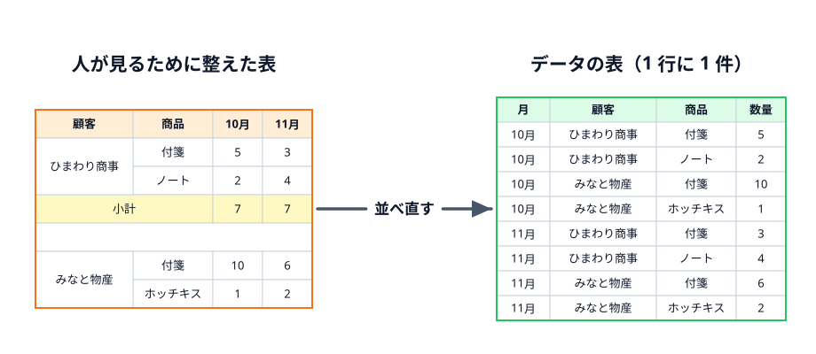
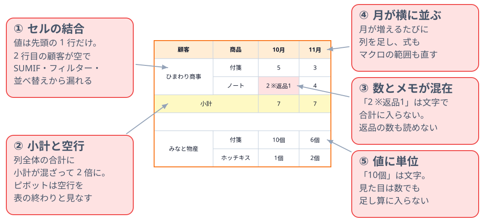

# 人が見る表と、データの表

第 6 章ではコードを書きません。ここまでのマクロがすんなり書けた理由を振り返り、**自分の職場で新しい表を作るときに何を意識すればよいか** を考えます。

第 3 章から第 5 章まで、マクロは売上シートを 2 行目から下へ 1 行ずつ読むだけで済みました。それは売上シートが「1 行に 1 件の売上」という素直な形をしていたからです。同じ 10 月の売上でも、表の形が違えば、関数もマクロもずっと書きにくくなります。

## 見やすく整えた表

そよかぜ文具店の店長が、売上を「見やすく」まとめたとします。顧客ごとに名前のセルを結合し、月を横に並べ、顧客の区切りに小計と空行を入れました。印刷して眺めるには、よくできた表です。

ところが、この表から「ひまわり商事の 10 月の合計」を関数で出そうとすると、途端に困ります。

| 崩れ | 何が困るか |
|---|---|
| ① セルの結合 | 結合したセルの値は先頭の 1 行にしか入っていない。2 行目の顧客は空なので、SUMIF・フィルター・並べ替えから漏れる |
| ② 小計と空行 | 列全体を合計すると小計まで足して 2 倍になる。ピボットテーブルやテーブルは、空行を「表の終わり」と見なして範囲を途中で切る |
| ③ 数とメモが同じセル | 「2 ※返品1」は文字なので、合計に入らない。返品が何個かも機械には読めない |
| ④ 月が横に並ぶ | 12 月になったら列を足し、式とマクロの範囲も直す。1 年で 12 回 |
| ⑤ 値に単位 | 「10個」は文字。見た目は数でも足し算に入らない |

どれも、人が目で読むぶんには問題になりません。困るのは、**関数・ピボットテーブル・マクロといった「機械」に読ませるとき** です。

## データの表の 3 つの決まり

機械が読みやすい表には、決まった形があります。

1. **1 行に 1 件** — 1 行が「1 回の売上」のような、数えられる 1 つの出来事を表す。小計・空行・メモの行は入れない。見出しは 1 行目の 1 行だけ
2. **1 列に 1 種類** — 日付の列には日付だけ、数量の列には数だけが入る。「10 月」「11 月」のように、値（月）を列の見出しにしない
3. **1 セルに 1 つの値** — 「付箋×5」は商品「付箋」と数量「5」の 2 列に分ける。返品のメモは「備考」の列に分ける。セルは結合しない

冒頭の図の右側が、同じ中身を 3 つの決まりで並べ直した表です。行は増えましたが、どの行も同じ形をしています。この形なら、

- SUMIF（スプレッドシートでも同じ）で「ひまわり商事の 10 月」をそのまま合計できる
- フィルターや並べ替えがどの列でも効く
- ピボットテーブルに渡すだけで、冒頭の「見やすい表」が作れる
- マクロは「2 行目から最後の行まで 1 行ずつ」の 1 つの形で全部の行を読める
- 12 月の売上は、下に行を足すだけ。式もマクロも直さない

このように、データを「重なりや崩れのない形」に整えることを、データベースの世界では **正規化** と呼びます。ここでの 3 つの決まりは、その最初の一歩（第 1 正規形）にあたります。

## 見やすい表は「作るもの」

「でも、上司に見せるのは横に月が並んだ表なんだけど」という声が聞こえてきそうです。見やすい表を捨てる必要はありません。**見やすい表は、データの表から作るもの** と考えます。

- 元のデータは、1 行に 1 件の表に溜める
- 人が見る表は、別のシートに関数（SUMIFS など）やピボットテーブルで作る。月が増えれば自動で増やせる
- 第 5 章の請求書のように、形の決まった帳票はマクロで作る

人が見る表に直接書き込み、そこから集計もする、という 1 枚で全部をこなす表が、いちばん崩れやすい表です。**入れる表と見せる表を分ける**。これだけで、関数もマクロもぐっと書きやすくなります。

:::notice[第 3 章のマクロを思い出す]
第 3 章の `SumByCustomer` は、売上シートを 2 行目から最後の行まで 1 行ずつ見て、顧客名が一致する行だけ足していました。もし売上シートに結合セルや小計行があったら、「顧客名が空なら 1 つ上の行の顧客を使う」「小計の行は飛ばす」といった例外の処理が必要になります。マクロが短く書けるかどうかは、コードの腕前より先に **表の形で決まります**。
:::

## Excel の「テーブル」を使う

1 行に 1 件の表ができたら、表計算ソフトの「テーブル（表）」の機能で囲んでおくと、形が崩れにくくなります。

:::::platform
::::excel
表の中のセルを 1 つ選んで「挿入」→「テーブル」（`Ctrl + T`）を押します。見出しにフィルターが付き、下に行を足すと書式も式も自動で広がります。式の中で `売上[数量]` のように列を名前で指せるので、範囲を `B2:B31` と書いて直し忘れることもなくなります。
::::
::::sheets
表の範囲を選んで「表示形式」→「表に変換」を押します。見出しにフィルターが付き、列ごとに「テキスト」「数値」「日付」などの種類を決められます。種類に合わない値（数の列に「10個」など）を入れると、その場で注意が出ます。
::::
:::::

## 確認クイズ

:::questions
- 顧客名のセルを結合すると、結合した 2 行目以降のセルには顧客名が入っていない [o]
- 「10個」と入力したセルは、SUM 関数でそのまま合計できる [x]
- 月ごとの売上は、月を列に並べた表で記録しておくのがよい [x]
- 1 行に 1 件の表に溜めておけば、月を横に並べた表はピボットテーブルで作れる [o]
- 見やすさのために、表の途中に小計の行を入れるとよい [x]
:::

:::faq

### 印刷するときは顧客名を結合したほうが見やすいのですが、どうすればよいですか？

印刷用・報告用のシートを別に作り、そちらで結合してください。元のデータのシートは結合しないままにしておきます。横に並んだ複数のセルの中央に文字を置きたいだけなら、Excel の「セルの書式設定」→「配置」→「選択範囲内で中央」を使うと、結合せずに見た目だけそろえられます。

### 今ある「横に月が並んだ表」を、1 行に 1 件の形に直すにはどうしますか？

数十行なら、新しいシートに手で並べ直すのがいちばん確実です。量が多いときは、Excel なら Power Query の「列のピボット解除」で、横に並んだ月を縦に並べ替えられます。いきなり元の表を壊さず、**新しいシートにデータの表を作り、元の表はしばらく残しておく** と安心です。

### 1 行に 1 件にすると、行が増えて見づらくなりませんか？

人が直接眺める表としては、見づらくなります。データの表は「機械に読ませる表」、見やすい表は「そこから作る表」と役割を分けてください。テーブル機能のフィルターや、ピボットテーブルを使えば、必要な切り口だけを見られます。

### 色でセルを塗って「未入金」などを表すのはだめですか？

色は人には分かりやすいのですが、関数で「黄色のセルだけ足す」ことは基本的にできません（マクロでもひと手間かかります）。意味のある色は、「入金状況」のような **列** にして、値（「未入金」「入金済み」）で書いてください。色を付けたいときは、その値をもとに条件付き書式で塗れば、見た目も保てます。

### 空行を入れないと、どこで表が区切れているのか分かりにくいのですが。

区切りが必要なのは、1 枚の表に複数のまとまり（顧客ごとのブロックなど）を作っているからです。まとまりは「顧客」の列の値で表し、見るときにフィルターや並べ替えで分けてください。どうしても見た目の区切りがほしいときは、空行ではなく罫線や条件付き書式で付けます。

:::
