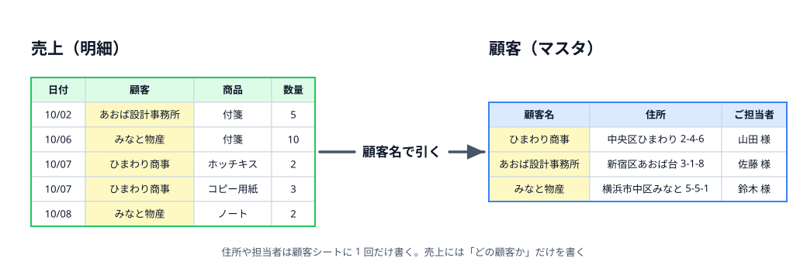
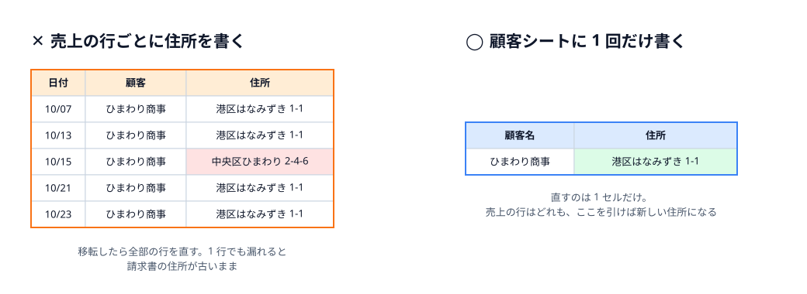
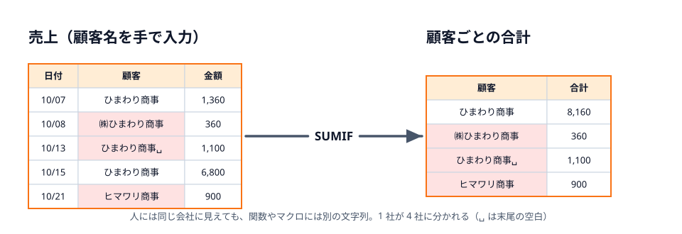
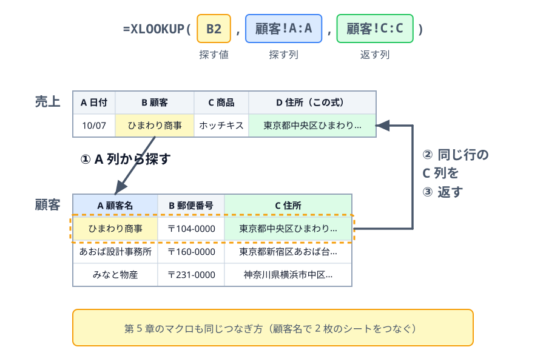
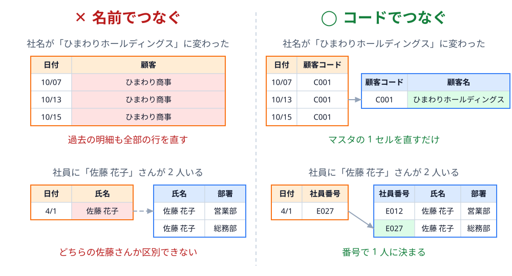
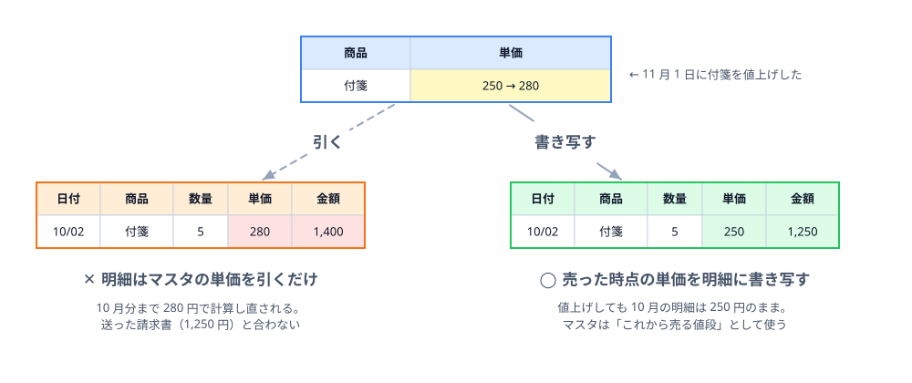

# 同じことは 1 か所にだけ書く



6-1 で、売上を 1 行に 1 件の表にしました。次は、その表に **何を書いて、何を書かないか** を考えます。

## 第 5 章のブックを思い出す

第 5 章の請求書には、宛名・住所・ご担当者が入りました。でも、売上シートに住所の列はありませんでした。住所は「顧客」シートにだけ書いてあり、マクロは顧客シートの 1 行を見て宛名を書いていました。

| 顧客名 | 郵便番号 | 住所 | ご担当者 |
|---|---|---|---|
| ひまわり商事 | 〒104-0000 | 東京都中央区ひまわり 2-4-6 | 総務部 山田 様 |
| あおば設計事務所 | 〒160-0000 | 東京都新宿区あおば台 3-1-8 | 事務担当 佐藤 様 |
| … | … | … | … |

なぜ、売上シートに住所の列を作らなかったのでしょうか。

## 全部の行に書くと、直し漏れが起きる

売上の行ごとに住所を書いたとします。ひまわり商事は 10 月だけで 7 行あるので、同じ住所を 7 回書くことになります。手間もかかりますが、本当に困るのは **住所が変わったとき** です。



1 行でも直し漏れると同じ会社に 2 つの住所ができ、請求書のマクロがどちらの行を読むかで送り先が変わってしまいます。

## 手で打つと、表記がゆれる

もう 1 つの問題は **表記ゆれ** です。顧客名を毎回キーボードで打っていると、同じ会社が少しずつ違う文字になります。



人には同じ会社に見えても、関数やマクロにとっては別の文字列です。SUMIF も、第 3 章のマクロの `If Cells(i, 2).Value = customerName Then` も、一致しない行を黙って飛ばします。エラーにならないので、合計が少ないことに気づきにくいのが厄介なところです。

顧客シートに正しい名前を 1 回だけ書き、売上ではそこから **選ぶ** ようにすれば、ゆれは起きません（選ばせる方法は 6-3 で扱います）。

## 明細とマスタに分ける

ここまでの考え方をまとめます。

- **明細** … 日々増えていく出来事の記録。売上、出欠、問い合わせなど。1 行に 1 件
- **マスタ** … 明細から何度も参照される「もの」の一覧。顧客、商品、社員など。1 行に 1 つ

明細には「どの顧客か」だけを書き、顧客の住所や担当者はマスタに書きます。**同じことは 1 か所にだけ書く**。これが正規化の 2 つ目の考え方です。

### マスタから引く

明細の行で顧客の住所を見たいときは、マスタから **引いて** きます。表計算ソフトでは XLOOKUP 関数を使います。売上シートの B 列の顧客名で、顧客シートの住所（C 列）を引くなら、次のように書きます。

```text
=XLOOKUP(B2, 顧客!A:A, 顧客!C:C)
```



XLOOKUP は Excel（Microsoft 365 / 2021 以降）とスプレッドシートのどちらでも使えます。古い Excel では `=VLOOKUP(B2, 顧客!A:D, 3, FALSE)` と書きます。

### 名前ではなくコードでつなぐ

この教材のブックは、分かりやすさを優先して顧客名で明細とマスタをつないでいます。実際の業務では、**顧客コード** のような番号でつなぐのがおすすめです。



コードは、一度振ったら変えない・使い回さない番号です。社員番号・商品コード・伝票番号など、社内にすでにある番号があれば、それを使うのがいちばんです。

## 分けすぎに注意: その時点の値は明細に残す

「同じことは 1 か所に」を突き詰めると、単価も商品マスタにだけ書けばよいように思えます。でも、これは落とし穴です。



売った時点の単価は「その取引で決まった事実」なので、**明細に書き写して残します**（そよかぜ文具店の売上シートに単価の列があるのは、このためです）。マスタの単価は、これから売るときに書き写す元として使います。

分けるか残すかは、次の問いで決めます。

| 問い | 答え | 書く場所 |
|---|---|---|
| 変わったら、過去の行にも反映したい？ | はい（住所、担当者、部署名の表示） | マスタ |
| 変わっても、過去の行はそのままにしたい？ | はい（単価、税率、そのときの所属） | 明細に書き写す |

## 確認クイズ

:::questions
- 顧客の住所は、売上の全部の行に書いておくと直すときに楽になる [x]
- 「ひまわり商事」と「ひまわり商事 」（末尾に空白）は、SUMIF では別の顧客として扱われる [o]
- 明細とマスタは、名前よりも変わらないコード（顧客コードなど）でつなぐのがよい [o]
- 商品の単価は商品マスタにだけ書き、売上の明細には書かないのが正しい [x]
- XLOOKUP は、ある値をマスタから探して同じ行の別の列を返す関数である [o]
:::

:::faq

### マスタは別のブック（ファイル）に分けたほうがよいですか？

最初は **同じブックの別シート** をおすすめします。別ブックにすると、ファイルを移動したり名前を変えたりしたときに参照が切れやすく、マクロもブックを開く手順が増えます。複数のブックから同じマスタを使いたくなったら、そのときに分けるか、データベースや共有のスプレッドシートへの移行を考えてください。

### 顧客コードはどうやって振ればよいですか？

`C001`、`C002` のような連番で十分です。会社の規模や地域などの意味をコードに持たせると、その意味が変わったときにコードも変えたくなるので避けます。退会した顧客のコードも、別の顧客に使い回さないでください。過去の明細が別の会社につながってしまいます。

### XLOOKUP で値が見つからないとエラーになります。

マスタに無い値を探すと `#N/A` になります。多くは表記ゆれ（末尾の空白、全角と半角の違い）か、マスタへの登録漏れです。エラーを隠すために `IFERROR` で空にしてしまうと、登録漏れに気づけなくなります。まずはエラーの出た行を見て、明細とマスタのどちらを直すべきか確かめてください。6-3 のプルダウンを使えば、そもそもマスタに無い値は入力できなくなります。

### マスタから引いた値を、明細にも値として貼り付けてよいですか？

単価のように「その時点の値を残したい」ものは、値として書き写すのが正解です。一方、住所のように「いつも最新を見たい」ものを値で貼ってしまうと、マスタを直しても明細は古いまま残ります。値で残すか、毎回引くかは、上の表の問いで決めてください。

### データベースの「正規化」とは同じものですか？

考え方は同じです。データベースの正規化には第 1 〜第 5 正規形などの段階がありますが、表計算ソフトで業務の表を作るなら、6-1 の 3 つの決まり（1 行 1 件・1 列 1 種類・1 セル 1 値）と、この節の「同じことは 1 か所に」の 2 つを押さえれば十分です。

:::
