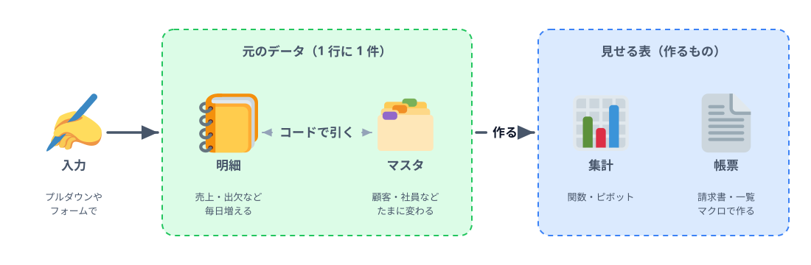
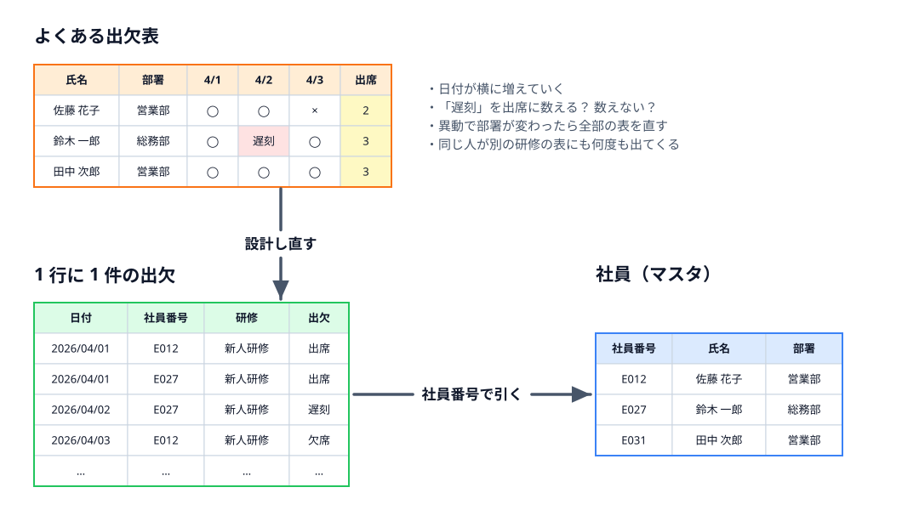
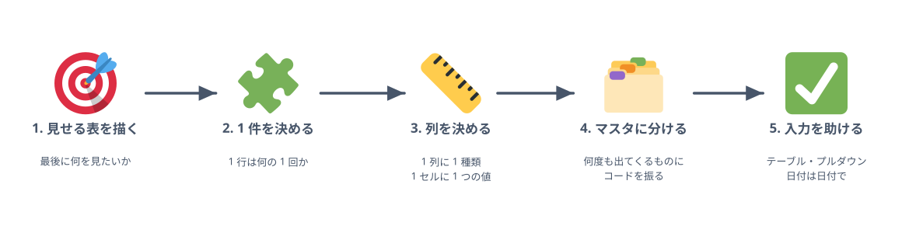

# 新しいシートを作るときに

6-1 と 6-2 で、扱いやすい表の形を見てきました。この節では、それを **自分の職場で新しいシートを作るとき** に使える手順にまとめます。題材は、どこの会社にもありそうな「研修の出欠表」です。

## よくある出欠表

新人研修の出欠を記録することになり、こんな表を作ったとします。

上の表は、見た目には分かりやすく、作るのも簡単です。でも、使い続けると次のことが起きます。

- 研修の日が増えるたびに列を足す。出席数の式の範囲も直す
- 「遅刻」を出席に数えるのか決まっていない。人によって数え方が変わる
- 部署が変わったら、この表も、ほかの研修の表も全部直す
- 「佐藤さんが今年受けた研修」を知りたくても、研修ごとに表が分かれていて集められない

6-1・6-2 の考え方で設計し直したのが、図の下の 2 つの表です。出欠は 1 行に 1 件、社員の情報は社員マスタに 1 回だけ。研修が増えても、日が増えても、下に行を足すだけです。「研修ごとの出席率」「部署ごとの受講状況」「佐藤さんの受講履歴」は、どれもこの 1 枚からピボットテーブルや関数で作れます。

## 設計の 5 つの手順

新しいシートを作るときは、いきなりセルに見出しを打ち始めず、次の順に考えます。

### 1. 見せる表を描く

最後に誰が何を見たいのかを、紙に描きます。「部署ごとの出席率を毎月報告する」「欠席した人に連絡する一覧がほしい」など。ここで描いた表は **作るもの** であって、入力する表ではありません。

### 2. 1 件を決める

「1 行は何の 1 回か」を一言で言えるようにします。出欠なら「1 人が 1 日の研修に出た（出なかった）1 回」。ここがぶれると、1 行に 2 件が入ったり、1 件が 2 行に分かれたりします。いちばん大事な手順です。

### 3. 列を決める

その 1 件について、記録しておきたいことを列にします。

- 1 列に 1 種類。日付の列、数の列、選択肢の列を分ける
- 1 セルに 1 つの値。メモは「備考」の列に逃がす
- 「出欠」のような選択肢は、取りうる値を先に決める（出席 / 欠席 / 遅刻）。「遅刻を出席に数えるか」は集計の側で決める
- 単位は見出しに書く（「時間（分）」）。値には数だけを入れる

### 4. マスタに分ける

列の中で、**同じ値が何度も出てきて、その値に付いてくる情報があるもの** を探します。社員（氏名・部署）、研修（名前・講師・会場）などです。これをマスタのシートに分け、コードを振って、明細にはコードだけを書きます。

ただし 6-2 のとおり、**その時点の値を残したいもの** は明細に書きます。たとえば「研修を受けたときの部署」で集計したいなら、部署は出欠の明細にも書き写しておきます。

### 5. 入力を助ける

形を決めても、入力のたびに崩れては意味がありません。入力する人が迷わない仕掛けを用意します。

:::::platform
::::excel
- **テーブルにする** … 表を選んで「挿入」→「テーブル」（`Ctrl + T`）。行を足すと書式・式・プルダウンが自動で広がる
- **プルダウンで選ばせる** … 列を選んで「データ」→「データの入力規則」→「入力値の種類」を「リスト」にし、元の値に社員マスタの社員番号の列を指定する。マスタに無い値は入力できなくなる
- **日付は日付で** … 「4/1」と入力すれば日付になる。「4月1日（火）」のように文字で打たない。曜日を見せたいときは表示形式で付ける
- **入力する列と、式の列を分ける** … 社員番号から氏名を XLOOKUP で引く列は、色を変えたりシートの保護をかけたりして、手で上書きされないようにする
::::
::::sheets
- **表に変換する** … 表を選んで「表示形式」→「表に変換」。列ごとに「テキスト」「数値」「日付」「プルダウン」の種類を決められる
- **プルダウンで選ばせる** … 列を選んで「データ」→「データの入力規則」→「プルダウン（範囲内）」にし、社員マスタの社員番号の列を指定する。「無効なデータの場合」を「入力を拒否」にすると、マスタに無い値は入らない
- **日付は日付で** … 「2026/4/1」と入力すれば日付になる。曜日を見せたいときは表示形式で付ける
- **入力する列と、式の列を分ける** … XLOOKUP で引く列は「データ」→「シートと範囲を保護」で、手で上書きされないようにする
::::
:::::

入力する人が多い、表計算ソフトに慣れていない、といった場合は、Microsoft Forms や Google フォームで入力してもらい、回答を 1 行に 1 件の表に溜める方法もあります。フォームは最初から「1 回の回答 = 1 行」なので、自然にデータの表になります。

## 新しいシートのチェックリスト

作り始める前と、作ったあとに見直すためのチェックリストです。

| | 確認すること |
|---|---|
| 1 件 | 「1 行は何の 1 回か」を一言で言える |
| 行 | 小計・合計・空行・メモの行が表の中に無い。見出しは 1 行だけ |
| 列 | 日付や月、人の名前が **列の見出し** になっていない |
| セル | 結合していない。1 つのセルに 2 つの値（数とメモ、商品と数量）が入っていない |
| 値 | 数の列に単位や文字が混ざっていない。日付は日付として入っている |
| 色 | 色に意味を持たせていない（意味は列の値で書き、色は条件付き書式で付ける） |
| マスタ | 何度も出てくる名前や住所はマスタに分け、コードでつないでいる |
| 履歴 | 単価や所属など「その時点の値」は、明細に書き写している |
| 入力 | プルダウンや入力規則で、マスタに無い値や形の違う値が入らない |
| 出力 | 人が見る表は、別のシートで関数・ピボット・マクロで作っている |

## やりすぎない

正規化は、表を長く・何人かで・自動化しながら使うための道具です。次のような表に、マスタを 3 つ作る必要はありません。

- 一度きりで捨てる表（飲み会の出欠、1 回だけのアンケートの集計）
- 自分しか使わず、数十行で終わる表

迷ったら、**毎月続くか・人に渡すか・関数やマクロで集計したいか** の 3 つを考えてください。どれかに当てはまるなら、最初に 5 分かけて 1 件と列を決めておくと、半年後の自分が助かります。

## 自動化とのつながり

第 5 章の請求書のマクロが数十行で書けたのは、売上が 1 行に 1 件で、顧客の情報が顧客シートにまとまっていたからです。表の形が崩れていたら、マクロの大半は「例外をよける処理」になっていたはずです。AI にマクロを書いてもらうときも同じで、「1 行に 1 件の売上シート（A 列 日付、B 列 顧客…）」と表の形を伝えられれば、返ってくるコードはずっと単純になります。

**自動化しやすい仕事は、表の設計から始まります。** 次に新しいシートを作るときは、見出しを打つ前に「1 行は何の 1 回か」を考えてみてください。

## やってみよう: 自分の職場の表を見直す

自分の職場で使っている表を 1 つ思い浮かべて（できれば実物を開いて）、次を書き出してみてください。

1. その表の「1 件」は何か。一言で言えるか
2. 上のチェックリストで引っかかる項目はどれか
3. 分けられそうなマスタは何か。コードに使える番号は社内にあるか
4. 最後に見たい表（出力）は何か。それは今の表から関数やピボットで作れるか

全部を直す必要はありません。次に同じような表を新しく作るときに、1 つでも取り入れてみてください。

## 確認クイズ

:::questions
- 新しいシートを作るときは、まず見出しを打ち始め、使いながら列を足していくのがよい [x]
- 「1 行は何の 1 回か」を決めることが、表の設計でいちばん大事な手順である [o]
- 「遅刻を出席に数えるか」のような数え方は、入力の段階ではなく集計の側で決める [o]
- プルダウンの選択肢をマスタの列から取ると、マスタに無い値を入力しにくくなる [o]
- 一度きりのアンケートの表でも、必ずマスタに分けて正規化するべきである [x]
:::

:::faq

### 今ある表をみんなが使っていて、形を変えられません。

いきなり置き換えなくて大丈夫です。今の表はそのまま残し、別のシートに 1 行に 1 件のデータの表を作って、新しい分からはそちらに入力してもらいます。今の表の形が必要なら、データの表から関数やピボットで「同じ見た目の表」を作って見せてください。見た目が変わらなければ、周りの人は気づかないまま移行できます。

### 入力する人にとっては、横に日付が並んだ表のほうが入力しやすいと言われます。

一覧で ◯ × を付けていく入力は、確かに速いです。その場合は、入力用のシート（横に並んだ表）と、データの表を分け、マクロで入力用シートからデータの表へ書き写す、という作り方もあります。第 5 章でやった「シートを読んで別のシートに書く」がそのまま使えます。入力のしやすさとデータの扱いやすさは、シートを分ければ両立できます。

### どのくらいの規模になったら、Excel ではなくデータベースや業務システムを考えるべきですか？

何人もが同時に入力する、権限を細かく分けたい、変更の記録を残したい、データが数十万行を超える、といった条件が出てきたら検討の時期です。そのときも、この章の考え方で作った表なら、明細とマスタがそのままデータベースのテーブルになります。正規化しておくことは、将来の移行の準備にもなります。

### 表の設計を AI に相談するとき、何を伝えればよいですか？

「最後に見たい表」と「1 件は何か」を伝えるのが近道です。たとえば「研修の出欠を記録して、部署ごとの出席率を毎月出したい。1 行は 1 人の 1 日の出欠」と伝えれば、列の案やマスタの分け方を提案してもらえます。返ってきた案は、この節のチェックリストで見直してください。

### コードを振るほどの番号が社内にありません。

まずは社内の既存の番号を探してください（社員番号、取引先コード、品番など）。経理や人事のシステムにたいてい何かあります。無ければ、マスタのシートで `E001` のような連番を自分で振ります。大事なのは、一度振ったら変えず、使い回さないことです。

:::
